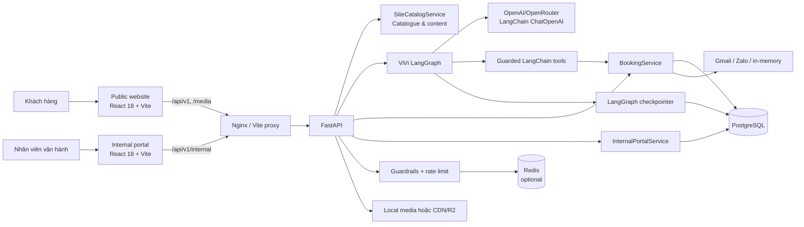
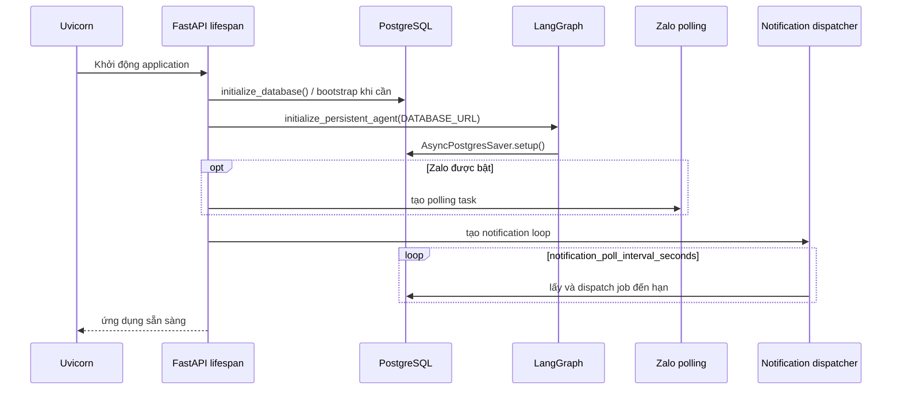
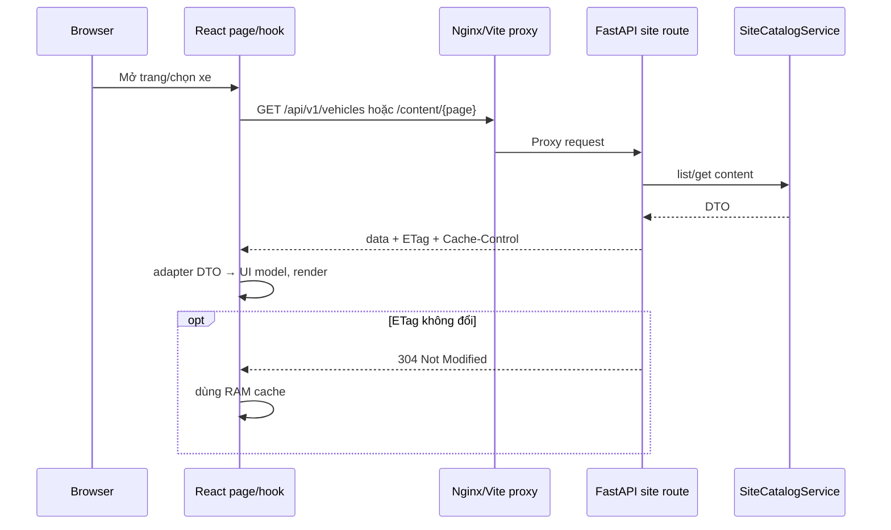
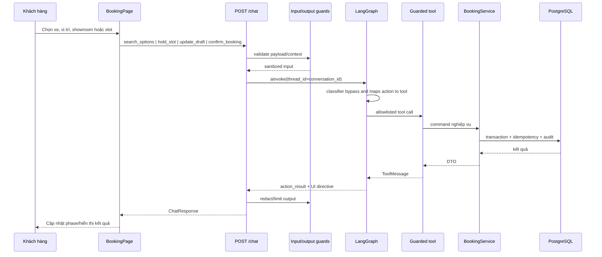
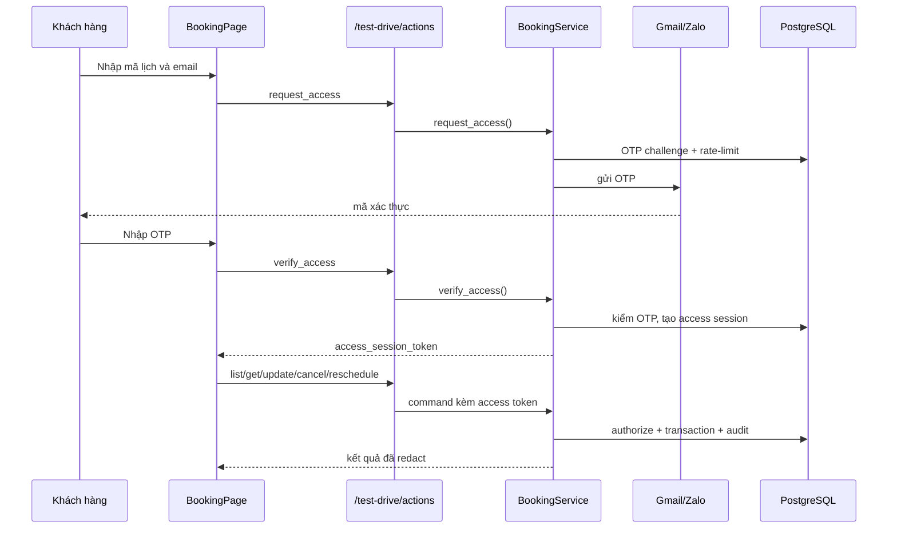
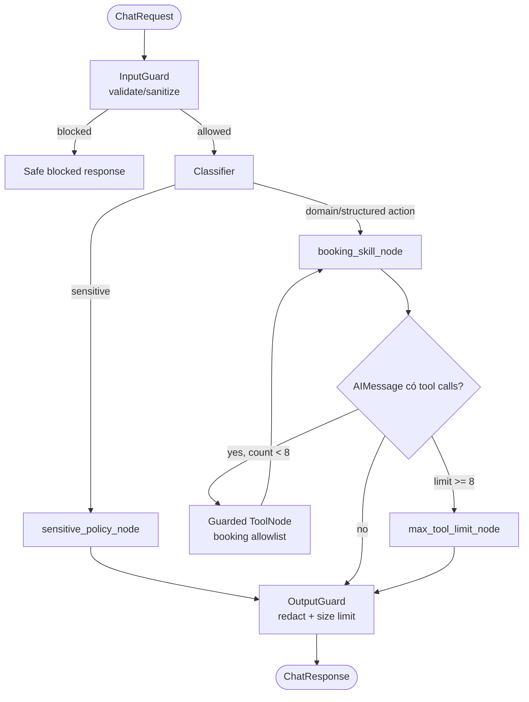
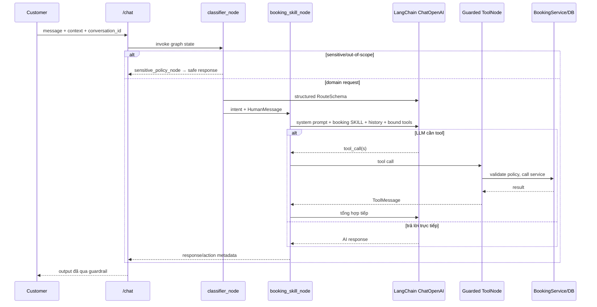

# Kiến trúc hệ thống VinFast Test Drive + ViVi

> Tài liệu mô tả implementation hiện có trong `frontend/src`, `internal-portal/frontend/src` và `backend/src`, rà soát ngày 21-08-2026. Source code là nguồn sự thật khi có khác biệt với tài liệu.

## 1. Tổng quan

Hệ thống phục vụ hành trình tìm hiểu xe và đặt lịch lái thử VinFast, gồm website công khai, trợ lý ViVi, portal nội bộ và một FastAPI backend dùng chung.



| Loại dữ liệu | Nguồn sự thật | Ghi chú |
| --- | --- | --- |
| Catalogue/content marketing | `SiteCatalogService` | API `/vehicles`, `/content/{page}` độc lập dữ liệu booking. |
| Showroom, xe demo, slot, booking, nhân sự | PostgreSQL qua service layer | Chỉ service được thực thi nghiệp vụ và ghi DB. |
| Lịch sử hội thoại | LangGraph checkpoint | Production dùng `AsyncPostgresSaver`; local SQLite/test dùng `MemorySaver`. |
| Trạng thái UI booking | React state + `sessionStorage` | Không phải nguồn sự thật của slot/booking. |
| Token portal | `sessionStorage`; hash/revocation trong PostgreSQL | Bearer token tới API nội bộ. |

## 2. Tech stack và triển khai

| Lớp | Công nghệ đang dùng |
| --- | --- |
| Public frontend | React 18, React Router, Vite, GSAP, Three.js, Mapbox GL, `@google/model-viewer` |
| Internal frontend | React 18, Vite |
| Edge | Nginx trong Docker; Vite dev proxy |
| Backend | Python, FastAPI, Pydantic Settings, Uvicorn |
| AI | LangChain, `langchain-openai`, LangGraph, PostgreSQL checkpointer |
| Persistence | PostgreSQL 16 qua psycopg; SQLite chỉ compatibility/test |
| Cache/rate limit | Redis 7, tùy chọn theo cấu hình |
| Messaging | Gmail OAuth, Zalo Bot/OTP, in-memory fallback |
| Media | `MEDIA_ROOT` mount tại `/media`; production có thể dùng `MEDIA_BASE_URL`/CDN |
| Container | Docker Compose: Postgres, Redis, backend, public frontend và portal (dev) |

`docker-compose.prod.yml` hiện triển khai PostgreSQL, Redis, backend và public frontend. Internal portal hiện có trong dev compose nhưng chưa được khai báo trong production compose.

## 3. Cấu trúc source code

```text
P-053/
├── frontend/                         # Website công khai
│   └── src/
│       ├── App.jsx, main.jsx          # Router, backend gate, entry point
│       ├── pages/                     # Home, CarDetail, Booking, Charging, AfterSales
│       ├── components/                # Shell, 3D, home sections, booking UI
│       ├── api/                       # HTTP client, booking, catalogue/content adapters
│       ├── context/                   # BackendStatusContext
│       ├── hooks/                     # useSiteData
│       ├── state/                     # bookingInteraction state machine
│       ├── data/, media/, styles/     # UI data, asset mapping, CSS
├── internal-portal/frontend/          # Portal vận hành
│   └── src/
│       ├── App.jsx, api.js            # Session/token + REST client
│       ├── pages/                     # Dashboard, bookings, fleet, team, schedule, audit…
│       └── components/                # Shell, notification, status/page state
├── backend/
│   ├── src/
│   │   ├── main.py                    # FastAPI, lifespan, middleware, /media
│   │   ├── config.py, dependencies.py # Settings và singleton services
│   │   ├── api/                       # Public chat/action/site API
│   │   ├── agents/                    # Graph, state, nodes, tools, prompts, skills
│   │   ├── guardrails/                # Input/tool/output guard và contracts
│   │   ├── services/                  # LLM, catalogue, Zalo, booking domain
│   │   ├── internal_portal/           # Auth RBAC, routes, operations, resources
│   │   ├── database/                  # DB adapter, schema, SQL guard, Redis
│   │   ├── security/                  # Client identity và rate limiting
│   │   └── models/                    # Public DTO
│   ├── tests/                         # API, agent, guardrail, booking, portal tests
│   └── scripts/                       # Seed/import, publish media, agent checks
├── eval/                              # Dataset, schema, fixtures/evaluation
├── docker-compose.yml                 # Local/dev stack
└── docker-compose.prod.yml            # Production stack
```

## 4. Backend architecture

### API boundary

| Nhóm | Endpoint chính | Vai trò |
| --- | --- | --- |
| Health | `GET /health`, `GET /api/v1/booking/health` | Liveness và DB/booking readiness. |
| Site | `GET /api/v1/vehicles`, `/vehicles/{id}`, `/content/{page}` | Catalogue/content; có ETag và Cache-Control. |
| Agent | `POST /api/v1/chat`, `POST /chat/stream` | Chat, structured action qua graph, SSE. |
| Booking command | `POST /api/v1/test-drive/actions` | Access/list/get/update/cancel/reschedule xác định trước; alias cũ `/demo/action`. |
| Internal | `/api/v1/internal/*` | Login, RBAC, dashboard, tài nguyên và vận hành booking. |
| Admin import | `/admin/import/*` | Chỉ `operations_admin`, chặn import security state. |

`main.py` gắn CORS, `RateLimitMiddleware`, request logging, portal error handler và static mount `/media`. Nginx proxy `/api/` và `/media/` về backend; SPA fallback xử lý React routes.

### Booking domain

`BookingService` là facade ghép các mixin:

- `catalog.py`: tìm showroom/slot theo xe, địa chỉ, tọa độ hoặc showroom.
- `lifecycle.py`: hold, draft, confirm và expire booking.
- `access.py`: OTP, access session, đọc lịch đã xác thực.
- `management.py`: cập nhật, đổi lịch, hủy lịch.
- `staff.py`: assignment, kiểm GPLX, check-in, complete, no-show.
- `notifications.py`, `background.py`: notification job/provider/dispatcher.
- `base.py`: transaction, audit event và idempotency.
- `importer.py`, `dashboard.py`, `location.py`: import, snapshot vận hành, khoảng cách.

Các bảng lõi gồm địa giới, showroom/giờ mở cửa, vehicle model/variant/demo vehicle, staff/shift/unavailability, slot, people/booking/driver detail, OTP/access session, event/idempotency, notification và internal user/audit. Metadata đầy đủ ở `backend/src/database/schema.py`.

### Startup và worker



Production sẽ fail startup nếu không khởi tạo được PostgreSQL checkpointer. Notification loop luôn chạy; Zalo polling chỉ chạy khi có đủ cấu hình/token.

## 5. Luồng frontend – backend

### Website công khai

`App.jsx` quản lý `/`, `/cars/:carId`, `/models/:carId`, `/booking`, `/charging`, `/after-sales`. `BackendStatusProvider` kiểm tra `/api/v1/booking/health` khi mở app, mỗi 30 giây và lúc browser online. `BackendGate` bọc toàn site, nên backend/database unavailable chặn cả trang marketing.

`api/client.js` dùng base URL `/api/v1`, cache GET trong RAM + `If-None-Match`, POST JSON không cache, và chuẩn hóa lỗi thành `ApiError`. `useSiteData` hủy request khi unmount; `adapters.js` chuyển DTO backend sang shape JSX.



### Đặt lịch mới qua structured action

#### Tìm showroom

`search_options` phân biệt hai ý nghĩa input:

- `address` hoặc GPS là **vị trí của khách**. Backend geocode thành tọa độ (GPS dùng trực tiếp), giữ mọi showroom còn slot cho model/variant rồi xếp theo khoảng cách Haversine. Token của địa chỉ chỉ không được dùng để loại showroom, nên khách ở Quế Sơn vẫn có thể nhận showroom Đà Nẵng gần hơn.
- `showroom_query` là **tên/mã showroom**. Backend chấm exact code/name, contains và token match, trả nhiều candidate theo điểm thay vì tự chọn `LIMIT 1`.
- Vùng rộng như “miền Bắc”, “miền Trung”, “miền Nam”, “miền Tây” trả stage `location_clarification`: không geocode vào một điểm đại diện, không ghim map và yêu cầu khách cung cấp tỉnh/thành hoặc GPS.

Candidate showroom chỉ được trả khi showroom active và có demo vehicle active, available, đủ pin **và có ít nhất một slot trống trong 30 ngày** (hoặc đúng bộ lọc ngày). API bổ sung `available_slot_count`, `nearest_slot_at` và `match_reasons`; frontend hiển thị số lịch trống trước khi khách chọn showroom.

Lọc lịch có ba contract loại trừ nhau: `preferred_date` cho một ngày, `preferred_dates` cho nhiều ngày rời nhau, và `preferred_date_from` + `preferred_date_to` cho khoảng liên tục tối đa 31 ngày. Catalog Service validate, query slot thật rồi trả `available_dates` và `highlighted_dates`. Frontend dùng trực tiếp structured result này cho calendar; không suy luận ngày bằng regex từ câu trả lời của agent.

Classifier dùng `booking_availability` cho câu hỏi ngày/giờ trống. Khi UI context đã có xe và showroom, lượt LLM đầu tiên bị ràng buộc phải gọi `search_test_drive_options`; sau ToolMessage, LLM được trả lời bình thường. `BookingError` được ToolNode đóng gói thành `{error: {code, message, retryable}}`, nhờ đó ViVi có thể hỏi lại tự nhiên trong chat trong khi UI vẫn nhận `action_error` ổn định.

Nút trong `BookingPage` gọi `frontend/src/api/booking.js`. Các action tạo booking mới đi tới `/chat`; classifier bypass LLM, booking skill map action sang tool. Vì vậy search/hold/update/confirm vẫn chạy khi không có LLM key.



Mutation dùng `ui_action_id`; service so operation/hash payload để replay an toàn hoặc từ chối reuse sai payload. `expected_version` bảo vệ optimistic concurrency khi update/confirm draft.

### Tra cứu, sửa, dời hoặc hủy booking

Nhóm này là deterministic command trực tiếp tại `/test-drive/actions`, không cần LLM/LangGraph. Khách cần OTP để nhận access session token.



### Portal nội bộ

Portal login qua `/internal/auth/login`, lưu token tại **sessionStorage** và gửi `Authorization: Bearer`. Backend xác thực opaque token đã hash trong DB rồi áp RBAC/phạm vi showroom qua `InternalPortalService` cho dashboard, booking lifecycle, catalog/fleet, shift/unavailability, transfer, notification, user và audit.

## 6. Luồng LangChain/LangGraph của ViVi

### Thành phần

- `services/llm.py`: tạo `ChatOpenAI`, ưu tiên OpenRouter rồi OpenAI; không có key trả `None`.
- `agents/graph.py`: `StateGraph`, routing và lifecycle checkpointer.
- `agents/state.py`: messages, intent, metadata, action/tool result và counter.
- `classifier_node.py`: keyword fast-path sensitive/out-of-scope; LLM structured `RouteSchema`; fallback keyword khi lỗi.
- `booking_skill_node.py`: chạy structured action hoặc `llm.bind_tools(...)` với chat tự do.
- `sensitive_policy_node.py`: phản hồi policy, không gọi tool.
- `agents/tools/*`: LangChain tool mỏng, gọi `BookingService` thay vì SQL trực tiếp.
- `tool_guard.py`: ToolNode được bọc bởi allowlist/policy theo skill.

Tool booking đăng ký trong graph: `search_test_drive_options`, `hold_test_drive_slot`, `get_booking_draft`, `update_booking_draft`, `request_booking_access`, `request_user_location`, `verify_booking_access`, `get_booking_details`, `confirm_test_drive_booking`.

`search_knowledge` và `advise_skill_node` có trong source nhưng **không được nối vào public graph hiện tại**; graph hiện chỉ public skill `booking`.



### Chat tự do



Hai giới hạn bảo vệ tool loop: `MAX_TOOL_CALLS = 8` ở graph và `guardrails_max_tool_calls_per_message` (mặc định 3) ở tool guard. `UsageBudgetService` giới hạn cost/call LLM theo ngày và session; khi vượt giới hạn node trả phản hồi an toàn.

`POST /chat/stream` (alias `/booking-agent/stream`) dùng `astream_events(..., version="v2")`, phát `on_chat_model_stream` qua SSE, rồi trả event `done` với `ChatResponse` đã qua OutputGuard. Không stream được thì fallback gọi `/chat`.

## 7. Bảo mật, tin cậy và quan sát

- Input guard giới hạn size/depth/node/string, kiểm action contract và sanitize message.
- Tool guard chỉ cho phép tool booking đã đăng ký; model không có đường SQL/endpoint tùy ý.
- Output guard redact dữ liệu nhạy cảm, giới hạn response/action data public.
- Rate limit dùng cookie server-issued + IP fallback, tách quota chat/action/OTP.
- OTP có TTL, cooldown, số lần thử tối đa, pepper server-side; production bắt buộc secret >= 32 ký tự và không trả mock OTP.
- Portal dùng opaque, revocable bearer session và RBAC; không tạo default credential từ code.
- Mutation booking dùng transaction, version check, idempotency và audit event.
- Trace/log có redaction cho request, LLM, tool và guardrail; HTTP middleware ghi status/latency.

## 8. Quy ước mở rộng

1. Production cần PostgreSQL vì conversation memory/checkpointer là bắt buộc.
2. Redis có thể tắt bằng `REDIS_ENABLED=false`.
3. Không đưa secret `.env`, Gmail refresh token, Zalo token hay OTP secret vào source/trace.
4. Thêm booking action: cập nhật đồng bộ DTO/guardrail contract → frontend API → action map/tool → BookingService/tests → UI directive nếu UI đổi phase.
5. Thêm LangGraph tool: export tool là chưa đủ; cần thêm graph list, ToolNode allowlist, tool policy/contracts và test security.
