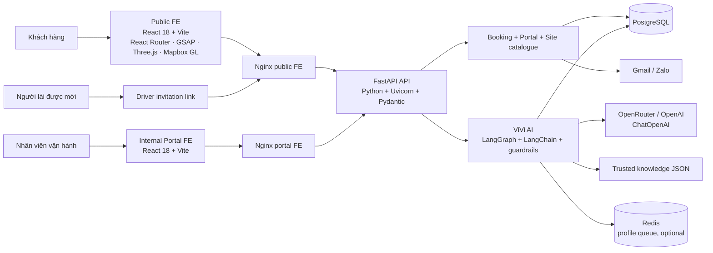
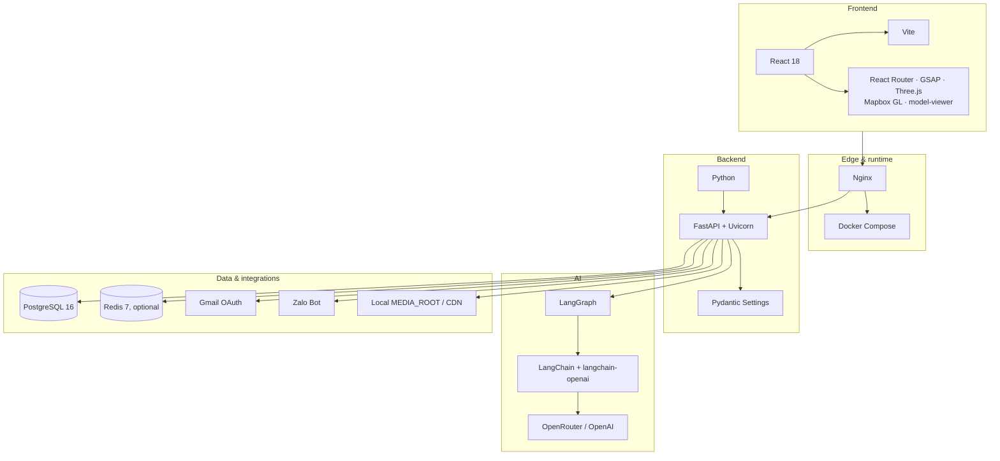
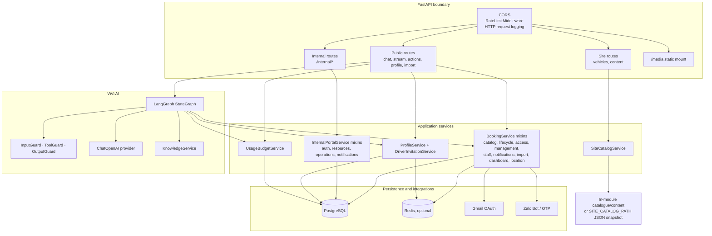
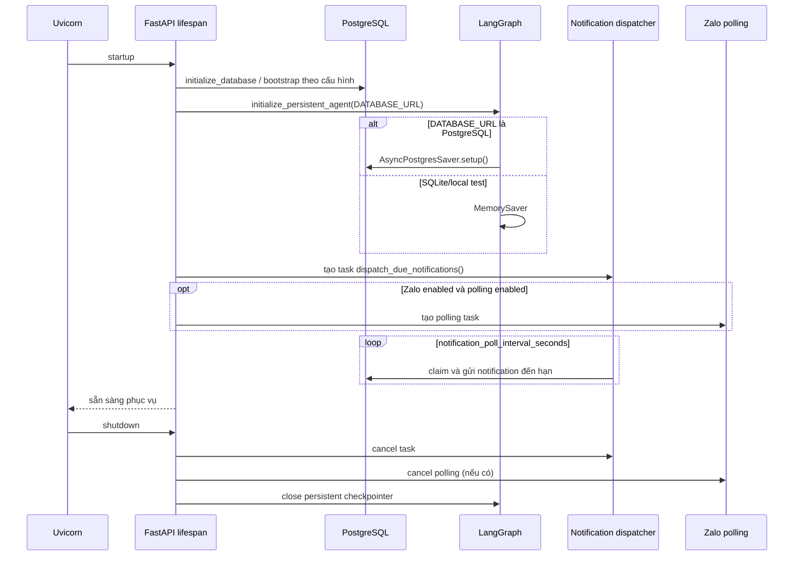
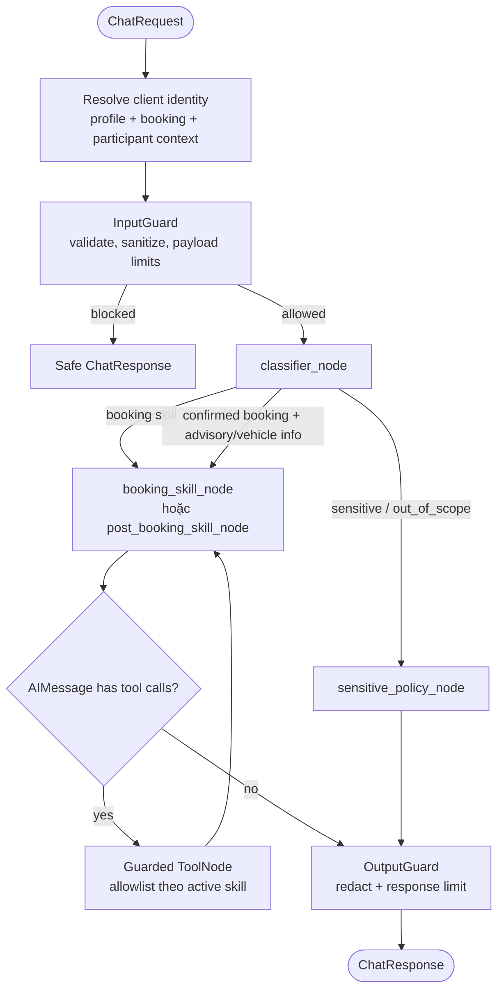
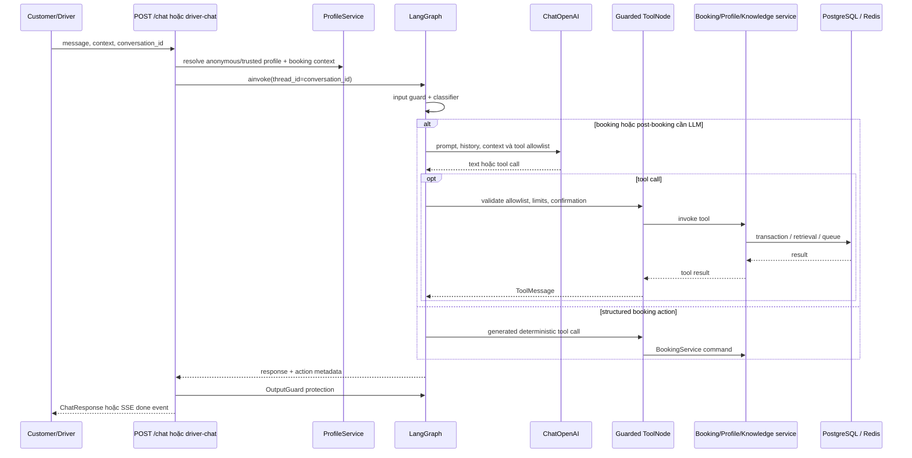
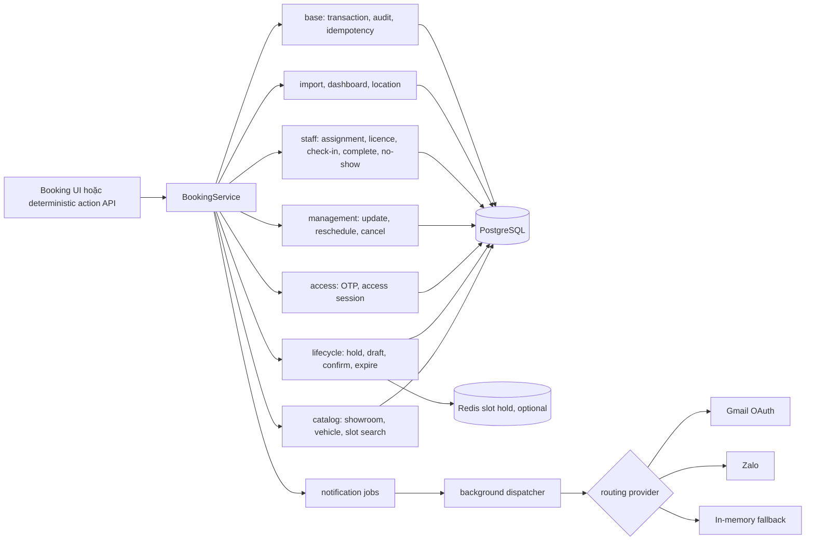
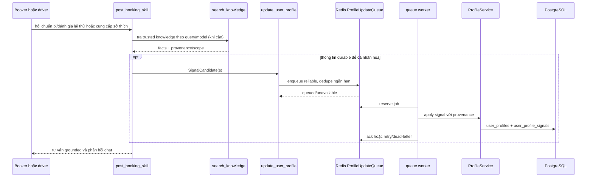

# Kiến trúc hệ thống VinFast Test Drive + ViVi

> Tài liệu phản ánh implementation hiện có trong source, rà soát ngày 23-08-2026. Khi khác biệt, source code là nguồn sự thật.

## 1. Tổng quan hệ thống

Sơ đồ này chỉ gom các khối backend chính; sơ đồ phía trên giữ chi tiết route, profile, media và từng service.

Các frontend đều gọi backend qua Nginx khi chạy Docker. `docker-compose.yml` có đủ Postgres, Redis, backend, public frontend và internal portal. `docker-compose.prod.yml` hiện chỉ khai báo Postgres, Redis, backend và public frontend; portal chưa nằm trong stack production.

## 2. Tech stack

## 3. Backend: lớp và trách nhiệm

`SiteCatalogService` không đọc catalogue từ PostgreSQL: nó dùng dữ liệu mặc định trong module hoặc snapshot JSON tại `SITE_CATALOG_PATH`, và trả ETag/Cache-Control. PostgreSQL là nguồn dữ liệu nghiệp vụ: showroom, xe demo, slot, booking, người dùng/phiên portal, OTP/access session, audit/idempotency, notification, profile và LangGraph checkpoint.

### Bề mặt API

| Nhóm | Endpoint chính | Xử lý |
| --- | --- | --- |
| Health | `GET /health`, `/api/v1/booking/health`, `/api/v1/status` | Liveness, trạng thái DB/agent. |
| Site | `GET /api/v1/vehicles`, `/vehicles/{id}`, `/content/{page}` | Catalogue/content read-only, ETag. |
| ViVi | `POST /api/v1/chat`, `/chat/stream` (alias `/booking-agent/stream`) | Chat/structured action; stream SSE. |
| Driver | `GET /driver-chat/{token}/context`, `POST /driver-chat/{token}/chat` | Chat theo link mời có thời hạn, cô lập conversation namespace. |
| Booking deterministic | `POST /api/v1/test-drive/actions` (alias `/demo/action`) | Search, hold/draft/confirm, OTP access, quản lý booking; không qua LLM. |
| Profile | `GET /user-profiles/{id}/…`, booking profile summary, driver invitation | Đọc summary/profile và tạo email link cho driver. |
| Internal | `/api/v1/internal/*` | Opaque bearer session, RBAC, dashboard, fleet, schedule, booking operations, audit. |
| Admin import | `/api/v1/admin/import/*` | Chỉ `operations_admin`; cấm import state bảo mật. |

## 4. Vòng đời ứng dụng và worker

Ở production, khởi tạo PostgreSQL checkpointer thất bại sẽ làm startup thất bại. Redis không bắt buộc cho backend: các chức năng Redis phụ thuộc như queue cập nhật profile sẽ báo unavailable nếu Redis không sẵn sàng.

## 5. ViVi: đồ thị AI thực tế

Classifier dùng keyword fast-path cho một số intent/safety cases, còn lại gọi LLM với structured `RouteSchema`; khi LLM không khả dụng/lỗi, code fallback về keyword/domain route. Structured booking actions bypass classifier LLM và map thẳng tới booking skill, vì vậy các button booking vẫn dùng được không cần API key LLM.

| Skill | Tool allowlist đang được nối vào graph | Ghi chú |
| --- | --- | --- |
| `booking` | `search_test_drive_options`, `hold_test_drive_slot`, `get_booking_draft`, `update_booking_draft`, `request_booking_access`, `request_user_location`, `verify_booking_access`, `get_booking_details`, `confirm_test_drive_booking` | Tool chỉ gọi `BookingService`; không có SQL trực tiếp từ model. |
| `post_booking` | `search_knowledge`, `update_user_profile` | Chỉ route khi booking đã active/confirmed; dùng knowledge JSON đã có provenance và profile context. |

`calculator` và `advise_skill_node` có trong source nhưng không được gắn vào graph công khai hiện tại. Không có vector-store/Chroma được dùng trong luồng `KnowledgeService` hiện hành; knowledge được tìm kiếm trên file JSON trusted.

### Luồng chat và tool

Provider LLM ưu tiên OpenRouter, sau đó OpenAI. `UsageBudgetService` ghi/kiểm soát ngân sách theo ngày và session trong PostgreSQL; giới hạn tool gồm tối đa 8 vòng ở graph và tối đa `guardrails_max_tool_calls_per_message` (mặc định 3) ở một message tool.

## 6. Booking và thông báo

Mutations dùng `ui_action_id` để idempotency và `expected_version` cho optimistic concurrency. OTP/access session bảo vệ tra cứu và chỉnh sửa booking. Driver invitation được tạo từ booking, gửi qua messaging provider; token chỉ dùng cho chat/context của driver và classifier chặn các thao tác booking management trên luồng này.

## 7. Post-booking profile và personalisation

Profile khởi đầu anonymous theo conversation/cookie. Khi booking được confirm hoặc OTP access được xác thực, backend có thể promote/merge profile theo person và hash email/phone; plaintext liên hệ không được đưa vào profile tool. Profile queue hiện cần Redis, và worker được start/stop ở event của public router.

## 8. An toàn, quan sát và dữ liệu

- `RateLimitMiddleware` tạo cookie identity phía server và IP fallback; counters nằm ở PostgreSQL. Quota được tách cho chat, deterministic action và OTP.
- Guardrails kiểm tra input/action contract, giới hạn payload, allowlist tool, explicit confirmation trước confirmation tool, giới hạn mutation batch và redact output.
- Portal dùng opaque bearer token chỉ lưu hash trong DB, có revoke và RBAC/scope showroom; frontend portal lưu token trong `sessionStorage`.
- Trace agent và HTTP logs thực hiện redaction. `client-log` cũng redact message/context trước khi log.
- `/media` là `MEDIA_ROOT` local mount; DTO có thể phát URL CDN bằng `MEDIA_BASE_URL`.
- Không đưa `.env`, Gmail refresh token, Zalo token, OTP secret hoặc driver invitation token vào source/log/documentation.

## 9. Quy ước mở rộng

1. Tool mới phải được thêm đồng thời vào tool module, allowlist của graph, guardrail policy/contract và test; export tool đơn lẻ chưa làm tool đó có thể gọi.
2. Skill mới cần node, routing classifier, ToolNode allowlist riêng và test permission boundary.
3. Thêm booking action cần đi xuyên DTO/guardrail → frontend API → action map/tool hoặc service → test/UI directive.
4. Production cần PostgreSQL cho conversation checkpoint bền vững; Redis nên được bật nếu sử dụng cập nhật profile bất đồng bộ.
