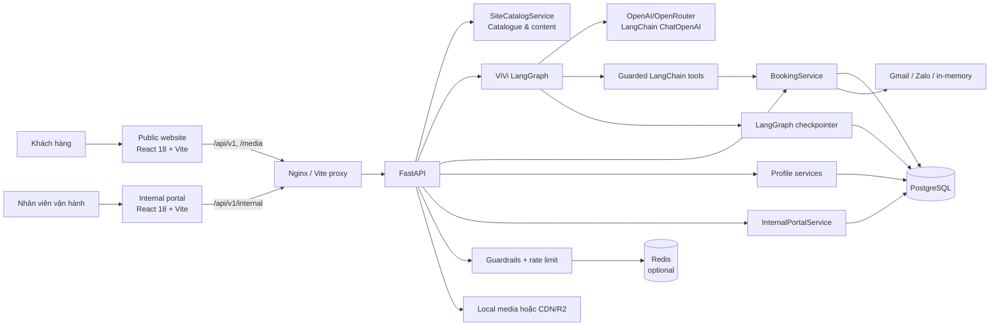
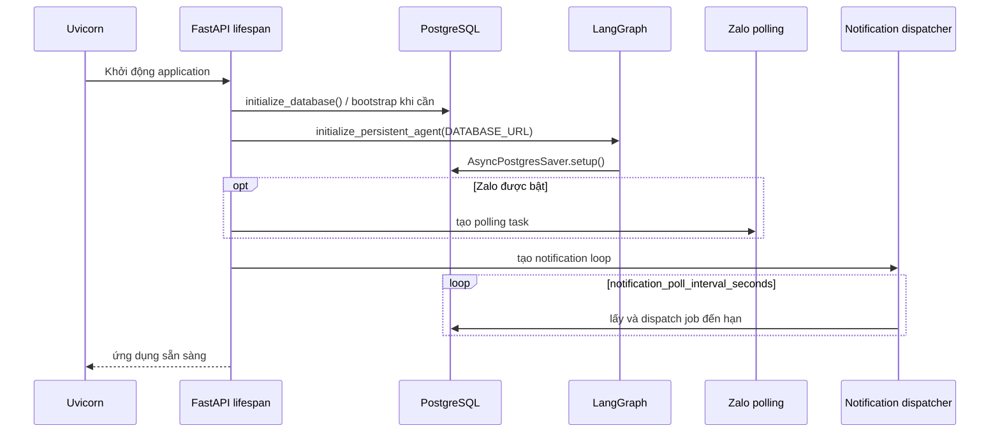
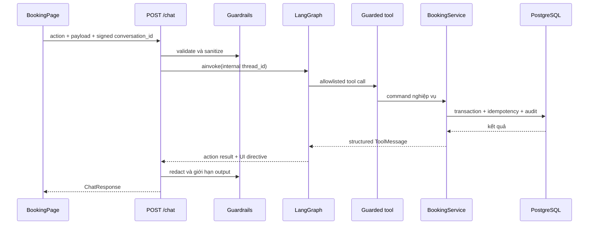
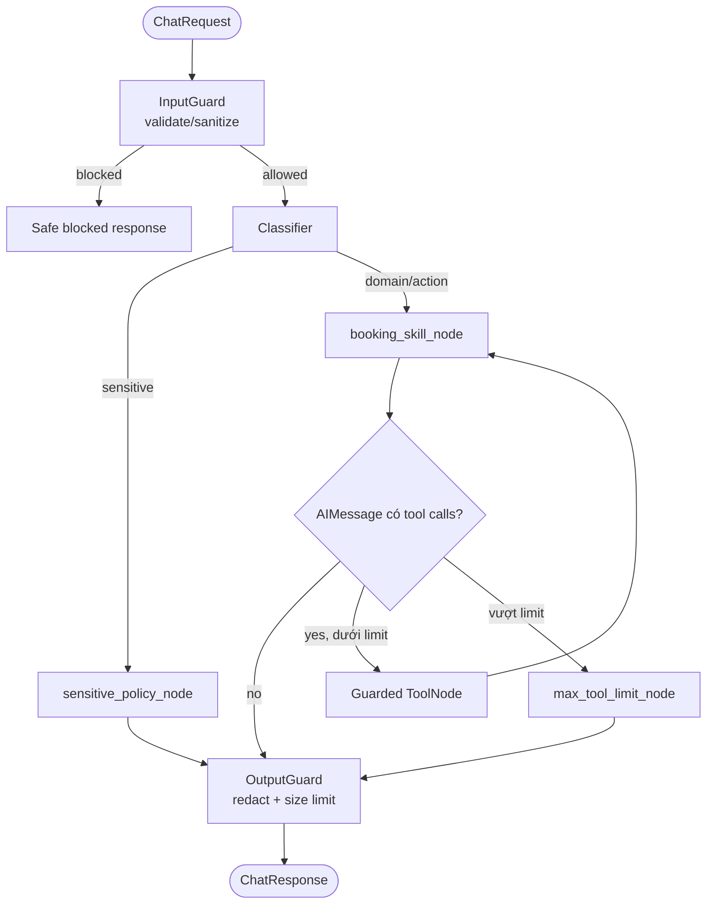

# Kiến trúc hệ thống VinFast Test Drive + ViVi

> Tài liệu mô tả implementation trong `frontend/src`, `internal-portal/frontend/src` và `backend/src`, được hợp nhất ngày 22-08-2026. Source code là nguồn sự thật khi có khác biệt với tài liệu.

## 1. Tổng quan

Hệ thống phục vụ hành trình tìm hiểu xe và đặt lịch lái thử VinFast, gồm website công khai, trợ lý ViVi, portal nội bộ và một FastAPI backend dùng chung.



| Loại dữ liệu | Nguồn sự thật | Ghi chú |
| --- | --- | --- |
| Catalogue/content marketing | `SiteCatalogService` | API `/vehicles`, `/content/{page}` độc lập dữ liệu booking. |
| Showroom, xe demo, slot, booking, nhân sự | PostgreSQL qua service layer | Chỉ service được thực thi nghiệp vụ và ghi DB. |
| Hồ sơ khách, booker/driver và lời mời tài xế | PostgreSQL qua profile services | Portal/admin đọc cùng dữ liệu để hỗ trợ sales. |
| Lịch sử hội thoại | LangGraph checkpoint theo internal `thread_id` | Client giữ signed conversation capability; backend xác minh rồi ánh xạ sang thread nội bộ. |
| Trạng thái UI booking | React state + `sessionStorage` | Không phải nguồn sự thật của slot/booking. |
| Token portal | `sessionStorage`; hash/revocation trong PostgreSQL | Bearer token tới API nội bộ. |

## 2. Tech stack và triển khai

| Lớp | Công nghệ đang dùng |
| --- | --- |
| Public frontend | React 18, React Router, Vite, GSAP, Three.js, Mapbox GL, `@google/model-viewer` |
| Internal frontend | React 18, Vite |
| Edge | Nginx trong Docker; Vite dev proxy |
| Backend | Python, FastAPI, Pydantic Settings, Uvicorn |
| AI | LangChain, `langchain-openai`, LangGraph, PostgreSQL checkpointer |
| Persistence | PostgreSQL 16 qua psycopg; SQLite chỉ compatibility/test |
| Cache/rate limit | Redis 7 và database counters; có process-local guardrail limiter |
| Messaging | Gmail OAuth, Zalo Bot/OTP, in-memory fallback |
| Media | `MEDIA_ROOT` mount tại `/media`; production có thể dùng `MEDIA_BASE_URL`/CDN |
| Container | Docker Compose: Postgres, Redis, backend, public frontend và portal (dev) |

`docker-compose.prod.yml` triển khai PostgreSQL, Redis, backend và public frontend. Internal portal hiện có trong dev compose nhưng chưa được khai báo trong production compose.

## 3. Cấu trúc source code

```text
P-053/
├── frontend/                         # Website công khai
│   └── src/
│       ├── pages/, components/       # Trang marketing, booking và UI dùng chung
│       ├── api/                      # HTTP client, booking, catalogue adapters
│       ├── state/                    # Booking interaction state
│       └── data/, media/, styles/    # UI data, asset mapping, CSS
├── internal-portal/frontend/          # Portal vận hành và sales
├── backend/
│   ├── src/
│   │   ├── main.py                    # FastAPI, lifespan, middleware, /media
│   │   ├── api/                       # Public chat/action/site API
│   │   ├── agents/                    # Graph, state, nodes, tools, prompts, skills
│   │   ├── guardrails/                # Input/tool/output guard và contracts
│   │   ├── services/booking/          # Booking domain
│   │   ├── services/profile/          # Customer profile và driver invitation
│   │   ├── internal_portal/           # Auth, RBAC, operations, resources
│   │   ├── database/                  # DB adapters, schema, SQL guard, Redis
│   │   ├── security/                  # Client identity và rate limiting
│   │   └── evaluation/                # Benchmark loader, metrics và reporting
│   ├── scripts/                       # Seed/import, media, email, evaluation
│   └── tests/                         # API, agent, guardrail, booking, portal, benchmark
├── eval/                              # Dataset, schema, fixtures và báo cáo evaluation
├── docker-compose.yml
└── docker-compose.prod.yml
```

## 4. Backend architecture

### API boundary

| Nhóm | Endpoint chính | Vai trò |
| --- | --- | --- |
| Health | `GET /health`, `GET /api/v1/booking/health` | Liveness và DB/booking readiness. |
| Site | `GET /api/v1/vehicles`, `/vehicles/{id}`, `/content/{page}` | Catalogue/content; có ETag và Cache-Control. |
| Agent | `POST /api/v1/chat`, `POST /chat/stream` | Chat, structured action qua graph, SSE. |
| Booking command | `POST /api/v1/test-drive/actions` | Command xác định trước; alias cũ `/demo/action`. |
| Driver/profile | `/driver-chat/*`, `/bookings/*/profile-summary.md`, `/user-profiles/*` | Context tài xế và tóm tắt hồ sơ hỗ trợ sales. |
| Internal | `/api/v1/internal/*` | Login, RBAC, dashboard, tài nguyên và vận hành booking. |
| Admin import | `/admin/import/*` | Chỉ `operations_admin`, chặn import security state. |

`main.py` gắn CORS, `RateLimitMiddleware`, request logging, portal error handler và static mount `/media`. Nginx proxy `/api/` và `/media/` về backend; SPA fallback xử lý React routes.

### Booking và profile domain

`BookingService` là facade ghép các mixin:

- `catalog.py`: tìm showroom/slot theo xe, địa chỉ, tọa độ, showroom và bộ lọc ngày.
- `lifecycle.py`: hold, draft, confirm và expire booking.
- `access.py`: OTP, access session, đọc lịch đã xác thực.
- `management.py`: cập nhật, đổi lịch, hủy lịch.
- `staff.py`: assignment, kiểm GPLX, check-in, complete, no-show.
- `notifications.py`, `background.py`: notification job/provider/dispatcher.
- `base.py`: transaction, audit event và idempotency.
- `importer.py`, `dashboard.py`, `location.py`: import, snapshot vận hành, khoảng cách.

Profile services resolve hồ sơ ẩn danh theo conversation/session, promote identity sau OTP hoặc booking, nối booker/driver với booking, tạo lời mời tài xế có hạn và cung cấp structured context/tóm tắt Markdown cho portal hoặc sales.

### Startup và worker



Production fail startup nếu không khởi tạo được PostgreSQL checkpointer. Notification loop luôn chạy; Zalo polling chỉ chạy khi có đủ cấu hình/token. Profile update queue được start/stop theo lifecycle của API router.

## 5. Luồng frontend – backend

### Website công khai

`App.jsx` quản lý các trang marketing, chi tiết xe và booking. `BackendStatusProvider` kiểm tra `/api/v1/booking/health`; `api/client.js` dùng base URL `/api/v1`, cache GET trong RAM + `If-None-Match`, POST JSON không cache và chuẩn hóa lỗi thành `ApiError`.

### Đặt lịch mới qua structured action

`search_options` phân biệt vị trí khách (`address` hoặc GPS) với tên/mã showroom (`showroom_query`). Vùng quá rộng trả `location_clarification`; candidate chỉ được trả khi showroom, demo vehicle, pin và slot đều khả dụng trong cửa sổ đặt lịch cấu hình được.

Ba contract ngày loại trừ nhau gồm `preferred_date`, `preferred_dates`, và `preferred_date_from` + `preferred_date_to`. Service query inventory thật và trả `available_dates`/`highlighted_dates`; frontend không tự suy diễn inventory.



`ui_action_id` và hash payload cho phép replay an toàn; `expected_version` bảo vệ optimistic concurrency khi update/confirm draft. `confirm_test_drive_booking` chỉ được chạy từ structured confirmation đã bind đúng payload, không được mở cho free-form LLM.

### Tra cứu, sửa, dời hoặc hủy booking

Nhóm này đi qua `/test-drive/actions`, không cần LLM. Khách phải xác thực OTP để nhận access session token; service kiểm permission và owner trước mỗi command. Portal dùng opaque bearer session, RBAC và showroom scope riêng.

## 6. Luồng LangChain/LangGraph của ViVi

- `classifier_node.py`: keyword fast-path, LLM structured route và fallback.
- `booking_skill_node.py`: structured action hoặc free chat với bound tools.
- `sensitive_policy_node.py`: policy response, không gọi tool.
- `advise_skill_node.py`: knowledge tool khi graph bật nhánh advise.
- `tool_guard.py`: allowlist, payload contract, confirmation binding và safe error serialization.
- `UsageBudgetService`: giới hạn cost/call theo ngày và session.



UI context được đưa vào LLM như dữ liệu tham chiếu không đáng tin cậy, không nối vào system role. Tool result cũng được bọc như untrusted content trước khi quay lại model. Khi hỏi availability và UI đã có xe/showroom, tool search được ép gọi để tránh trả lời từ memory.

`POST /chat/stream` (alias `/booking-agent/stream`) gọi cùng canonical chat handler để giữ nguyên conversation verification, rate/abuse limits, profile context và guardrails; response đã bảo vệ được chia thành SSE `token` events rồi kết thúc bằng event `done`.

## 7. Bảo mật, tin cậy và quan sát

- Signed conversation capability có TTL; token sửa/hết hạn được thay bằng thread cô lập mới và không dùng trực tiếp làm checkpoint key.
- Input guard giới hạn size/depth/node/string, kiểm allowlist context/action, normalize Unicode và chặn injection/abuse.
- Vi phạm injection hoặc abusive language tích lũy strike theo conversation/IP; đạt ngưỡng sẽ bị ban có `Retry-After`.
- Tool guard chỉ cho tool đăng ký, chặn duplicate/batch mutation trái policy và bind confirmation với UI action.
- Output guard loại internal analysis, redact credential/OTP/contact và giới hạn kích thước response/action data.
- Rate limit nhiều lớp dùng cookie session, IP, conversation và quota riêng cho chat/action/OTP.
- OTP có TTL, cooldown, số lần thử tối đa, pepper server-side; production không trả mock OTP.
- Mutation booking dùng transaction, version check, idempotency và audit event.
- Trace/log redact request, LLM và tool data; HTTP middleware ghi status/latency.

## 8. Benchmark và kiểm thử

Benchmark agent nằm trong `backend/src/evaluation`, dataset/report trong `eval/` và entrypoint ở `backend/scripts/run_agent_evaluation.py`. Schema benchmark 1.1 bắt buộc coverage tối thiểu theo category; CI chạy correctness/security/latency metrics cùng mutation tests cho injection detection, output sanitization, confirmation binding, conversation verification, rate limiting và abuse threshold.

Các thay đổi booking/agent cần chạy unit/integration tests, benchmark, Ruff và frontend checks tương ứng trước khi merge.

## 9. Quy ước mở rộng

1. Production cần PostgreSQL vì conversation memory/checkpointer là bắt buộc.
2. Redis có thể tắt bằng `REDIS_ENABLED=false`; rate-limit production vẫn cần cấu hình datastore phù hợp.
3. Không đưa secret `.env`, Gmail refresh token, Zalo token hay OTP secret vào source/trace.
4. Thêm booking action: cập nhật DTO/guardrail contract → frontend API → action map/tool → service/tests → UI directive.
5. Thêm LangGraph tool: cập nhật export, graph list, ToolNode allowlist, policy/contracts và security tests.
6. Thêm dữ liệu hồ sơ: xác định nguồn tin cậy, consent/scope hiển thị, redaction và audit trước khi đưa vào context cho agent hoặc sales.
