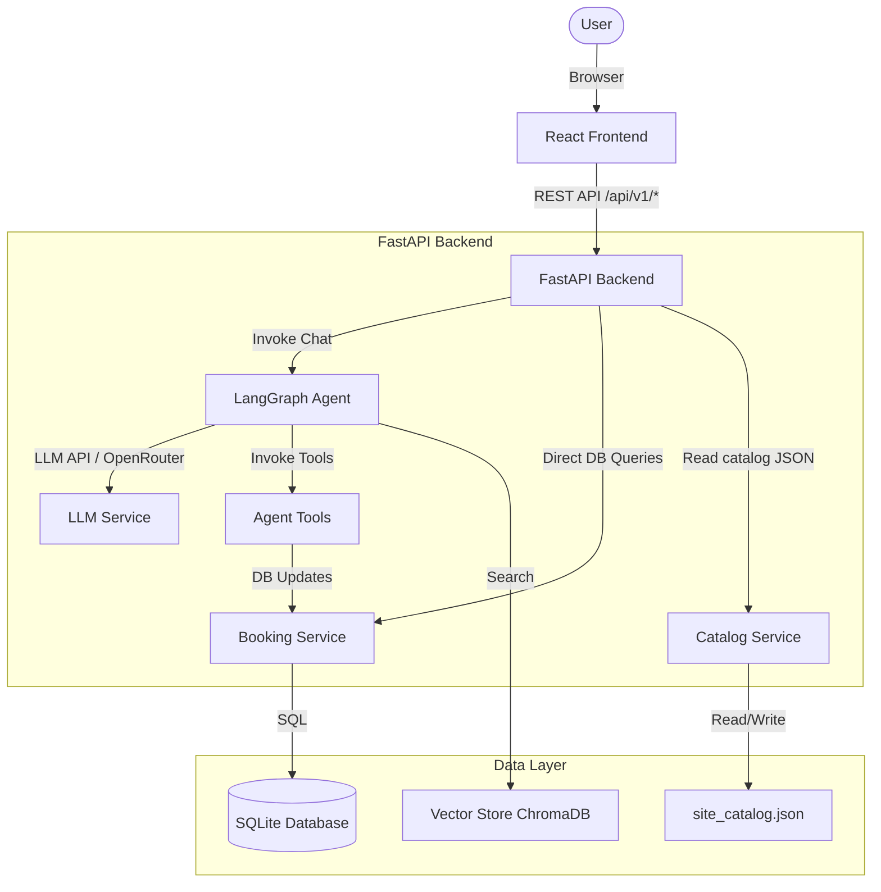
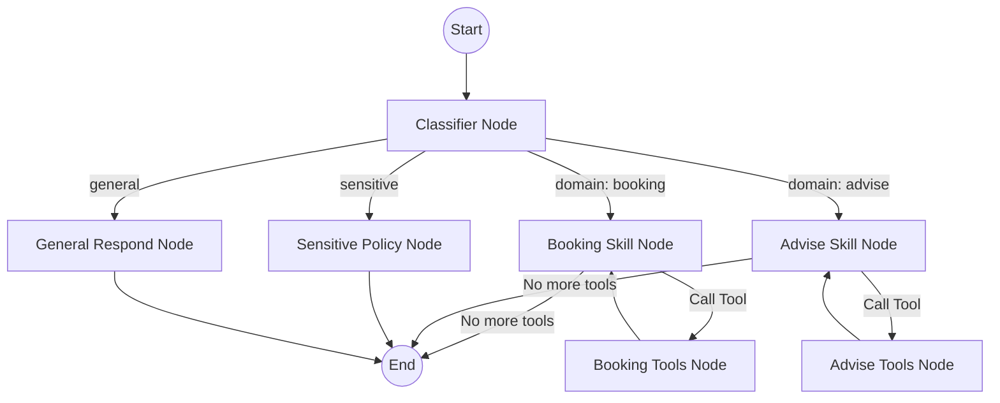

# VinFast Test Drive Booking Platform - Architecture Document

This document outlines the system architecture, component design, data flow, and current implementation status of the VinFast Test Drive Booking and Catalog platform.

## System Overview

The VinFast Test Drive Booking Platform is a hybrid system combining a responsive **React Frontend** and a **FastAPI Backend** with an **orchestrated AI Agent (LangGraph)**. The platform allows users to explore the VinFast vehicle catalog, read brochures, and book test drives.

The system is designed with a dual-mode interaction model for booking:
1. **Deterministic UI Actions**: Direct client-side calls to backend services/tools (e.g., clicking on a slot directly invokes the booking tool).
2. **AI Agent (ViVi)**: An interactive chatbot that guides the user through booking, answering general questions, and enforcing policies via natural language.

---

## Architecture Diagram



---

## Components

### 1. Frontend (React)
- **Technology Stack**: React, Vanilla CSS, Vite, Phosphor Icons, GSAP (animations).
- **Core Views**:
  - **Home**: Banner slider, factory showcase, and vehicle grid.
  - **Car Details**: Vehicle variant chooser, specifications table, and color selector.
  - **Charging & After-Sales**: Charging network facts and warranty brochures.
  - **Booking (ViVi Chat)**: Split-screen interface with a map (showroom locations), calendar/slots selector, and a chat sidebar interacting with the AI Agent.
- **State Management**: React state hooks (`useState`, `useContext`) managing booking draft state, UI steps, and agent messages.

### 2. Backend (FastAPI)
- **API Design**: RESTful API endpoints for:
  - `/vehicles` & `/vehicles/{id}`: Returns catalogue data.
  - `/content/{page}`: Returns structured content for static pages.
  - `/chat`: Main entry point for the LangGraph AI Agent.
  - `/dashboard`: Monitoring dashboard for showrooms and slots.
- **Cache Control**: Employs ETags and `If-None-Match` caching for catalog and content endpoints to optimize bandwidth.

### 3. AI Agent (LangGraph State Machine)
The AI Agent handles user queries and orchestrates the booking process using a state graph.



* **Classifier Node**: Classifies user intent (`sensitive`, `general`, or `domain`) and sets the `active_skill` (`booking` or `advise`).
* **Sensitive Policy Node**: Applies guardrails to block off-topic, political, or toxic inputs.
* **General Respond Node**: Answers casual questions or greetings.
* **Booking Skill Node**: Binds booking-related tools, parses inputs, and updates the booking state.
* **Advise Skill Node**: Handles Q&A about VinFast models and policies.

#### Agent Tools:
* **Booking Tools**: `search_test_drive_options`, `hold_test_drive_slot`, `get_booking_draft`, `update_booking_draft`, `request_booking_access`, `verify_booking_access`, `get_booking_details`, `confirm_test_drive_booking`.
* **Advise Tools**: `search_knowledge` (RAG search).
* **Utility Tools**: `calculator`.

### 4. Database (SQLite)
The application uses SQLite (`backend/data/app.db`) to manage:
- Showrooms, demo vehicles, and test-drive slots.
- People (customers, drivers).
- Bookings (holds, confirmations, reschedules, cancellations).
- OTP challenges and session access tokens for secure booking lookup.
- Notification jobs (queued reminders and confirmations).

### 5. Vector Store (ChromaDB)
- **Engine**: ChromaDB (local persistence dir: `./data/chroma`).
- **Purpose**: Stores embeddings of brochure PDFs and website pages to support Retrieval-Augmented Generation (RAG).

---

## Current Status & Mocked Features

While the application framework is fully designed, several advanced AI and communication features are **mocked or in a semi-active state** during development:

### 1. AI Agent (ViVi) Integration
- **LLM Availability**: The agent relies on an API key (`OPENROUTER_API_KEY` or `OPENAI_API_KEY`) to run. If no key is set or the configured model is unavailable, the backend falls back to returning a safe connection error message.
- **Model Compatibility**: Currently configured to use `nvidia/nemotron-3-ultra-550b-a55b:free` on OpenRouter. Free-tier models often lack native, reliable support for tool-calling, which may cause natural language booking steps to fail or fall back to deterministic UI flows.

### 2. Knowledge Retrieval (RAG / Vector Store)
- **Current State**: The knowledge lookup tool `search_knowledge` is currently a **stub/mock** that simply echoes back the search query:
  ```python
  @tool
  def search_knowledge(query: str) -> str:
      return f"Kết quả tìm kiếm cho: {query}"
  ```
  The ChromaDB vector store is not populated with live vector data for search queries in production.

### 3. Notification Service
- **SMS / Email / Zalo Delivery**: The notification delivery engine is a deterministic mock adapter:
  ```python
  # backend/src/services/booking/notifications.py
  """Deterministic development adapter with an explicit mock contract."""
  ```
  It generates fake message IDs (`mock_...`) and marks notification jobs as `sent` in the database without integrating with actual SMS gateways (e.g., Twilio, Zalo ZNS) or email providers.

### 4. Site Catalog & Media Data
- **Static CMS Snapshots**: Vehicle specifications and page content are fetched from static, local JSON/Markdown assets (`site_catalog.json`, `Ảnh xe vinfast`, `Vinfast Brochure` directories) rather than an active headless CMS or live external inventory database.

---

## Design Decisions

| Decision | Choice | Reason |
|----------|--------|--------|
| **Backend Framework** | FastAPI | High-performance async support, automatic OpenAPI/Swagger documentation, and Pydantic validation. |
| **Agent Framework** | LangGraph | State-machine based orchestration, perfect for controlling conversational flows and tool-calling loop bounds. |
| **Database** | SQLite | Lightweight, file-based database requiring zero setup, ideal for testing and prototype evaluation. |
| **Frontend Framework** | React / Vite | Rapid client-side rendering, module building, and interactive stateful layouts. |
| **Notification Adapter** | Mock Provider | Prevents accidental delivery charges during development and allows offline testing. |
