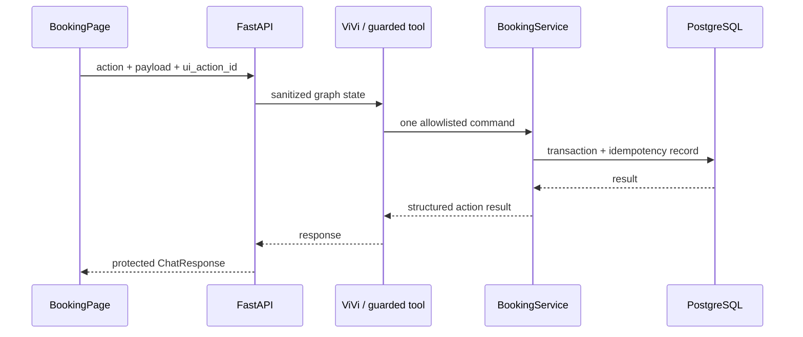
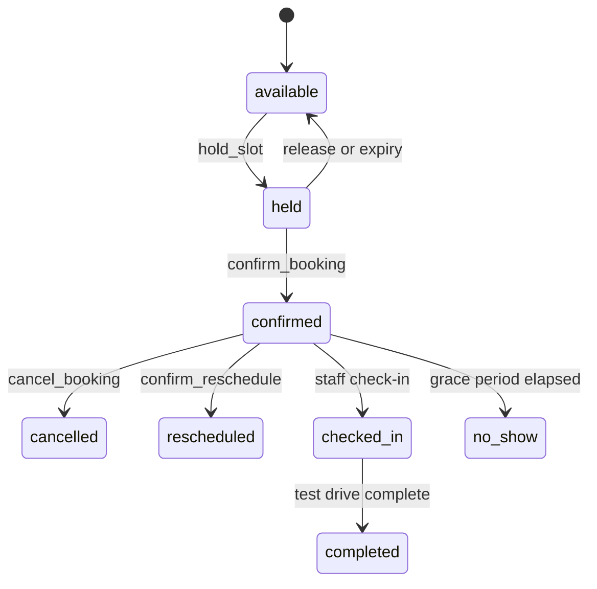

# VinFast Test Drive Platform — Architecture

## 1. Scope

The platform combines a React catalogue/test-drive booking UI with ViVi, a LangGraph agent. The deterministic UI and the agent both use the same backend booking services; the agent never writes to the database directly.

The default runtime datastore is PostgreSQL. A SQLite adapter remains available for local compatibility and tests. The LLM is optional: catalogue and deterministic booking endpoints continue to work when no provider key is configured.

## 2. System overview

```mermaid
flowchart LR
    customer["Customer"] --> web["React frontend\nNginx"]
    web -->|"REST /api/v1"| api["FastAPI"]

    subgraph backend["Backend"]
        api --> content["Catalogue / content services"]
        api --> chat["Chat route"]
        chat --> input["Input guard"]
        input --> graph["LangGraph ViVi agent"]
        graph --> tools["Guarded tool nodes"]
        tools --> booking["Booking service"]
        graph --> llm["OpenAI / OpenRouter\noptional"]
        chat --> output["Output guard"]
    end

    content --> media["Static catalogue + local/CDN media"]
    booking --> postgres[("PostgreSQL")]
    booking -. test / legacy .-> sqlite[("SQLite adapter")]
    graph --> rag["Knowledge-search boundary"]
    rag --> chroma[("ChromaDB, optional")]
```

### Runtime boundaries

| Layer | Responsibility | Can mutate booking data? |
| --- | --- | --- |
| React frontend | UI state, request orchestration and rendering | Only by calling backend commands |
| FastAPI | HTTP/Pydantic validation, API response and tracing | Only through service calls |
| Guardrails | Deterministic AI-boundary enforcement | No |
| LangGraph | Intent routing, response/tool orchestration | Only through allowlisted tools |
| Booking service | Domain invariants, authorization and idempotency | Yes |
| Database adapter | PostgreSQL runtime; SQLite compatibility/test support | Persists transactions |
| Catalogue service | Read-only vehicle/content DTOs and media URLs | No |

## 3. Request and AI safety flow

`/api/v1/chat` creates a conversation ID when needed and uses it as the LangGraph `thread_id`. Guardrails are enforced around the agent, rather than relying on prompt instructions alone.

```mermaid
sequenceDiagram
    participant C as Client
    participant API as FastAPI /chat
    participant IG as InputGuard
    participant G as LangGraph
    participant TG as GuardedToolNode
    participant S as Booking or knowledge tool
    participant OG as OutputGuard

    C->>API: ChatRequest
    API->>IG: validate, normalize and inspect input
    alt input blocked
        IG-->>API: safe error code/message
        API-->>C: ChatResponse; no LLM/tool call
    else input accepted
        API->>G: ainvoke(thread_id, sanitized state)
        G->>TG: proposed tool call(s)
        alt tool blocked
            TG-->>G: normalized ToolMessage error; no side effect
        else tool allowed
            TG->>S: execute allowlisted tool
            S-->>G: result
        end
        G-->>API: agent result
        API->>OG: redact, hide analysis, truncate
        OG-->>API: protected response
        API-->>C: public ChatResponse
    end
```

### What deterministic guardrails enforce

| Enforcement point | Controls |
| --- | --- |
| InputGuard, before `agent.ainvoke()` | Conversation ID and action contracts; payload size/depth/node/string limits; text normalization; known prompt/role-injection patterns |
| GuardedToolNode, immediately before a tool | Active-skill allowlist; maximum tool calls per model message; object-shaped and bounded arguments; duplicate calls; one mutation at a time; explicit confirmation for booking confirmation |
| OutputGuard, before `ChatResponse` | Hides internal analysis; redacts secrets, OTP/access-token and personal-data patterns; blocks system-prompt leakage; bounds public output size |

Guardrails do not replace authentication, gateway rate limiting, Pydantic validation, booking-domain validation, database authorization, or monitoring. They are a deterministic defense-in-depth layer for the AI/tool boundary. They can be configured with `GUARDRAILS_*` variables; production should keep `GUARDRAILS_ENABLED=true`.

## 4. Guardrails versus the classifier

The two components solve different problems and are intentionally both present.

| Aspect | `classifier_node` | Guardrails |
| --- | --- | --- |
| Primary job | Select the agent route/skill | Enforce safe input, tool use and output |
| Placement | Inside LangGraph, at graph entry | Before graph, before tool execution and after graph |
| Mechanism | Keyword shortcuts plus structured LLM classification; keyword fallback when LLM is unavailable | Code and centralized policies; no LLM call |
| Output | `intent`, `sub_intent`, `active_skill` | Allow/block decision, sanitized text or protected output |
| Failure stance | Falls back to a usable route | Fails closed at protected boundaries |
| Security guarantee | None by itself: it may make an incorrect routing decision | Enforces configured limits and allowlists regardless of model output |

For example, the classifier may route “book a VF 8 test drive” to the booking skill. That does **not** authorize a booking: the guarded tool node still checks the tool name, arguments, call budget and explicit confirmation; the booking service then enforces its business and authorization rules. Conversely, an input blocked by `InputGuard` never reaches the classifier or an LLM.

## 5. LangGraph agent

The graph in `backend/src/agents/graph.py` uses `MemorySaver` to retain conversation state per `thread_id` within the running process.

```mermaid
flowchart TD
    start(["Sanitized chat state"]) --> classifier["classifier_node"]
    classifier -->|"sensitive"| sensitive["sensitive_policy_node"]
    classifier -->|"domain + booking"| booking["booking_skill_node"]
    classifier -->|"domain + advise"| advise["advise_skill_node"]

    booking -->|"tool calls, under graph limit"| bookingGuard["GuardedToolNode\nbooking allowlist"]
    bookingGuard --> booking
    advise -->|"tool calls, under graph limit"| adviseGuard["GuardedToolNode\nknowledge allowlist"]
    adviseGuard --> advise

    sensitive --> end(["End"])
    booking -->|"no tool call / limit reached"| end
    advise -->|"no tool call / limit reached"| end
```

### Classifier routing

1. A structured UI action or `booking` channel bypasses LLM classification and routes directly to the booking skill.
2. Sensitive and out-of-scope keyword checks route directly to `sensitive_policy_node`.
3. Other requests use a structured LLM classification into `domain` or `sensitive` and a sub-intent. Domain requests use either the booking or advice skill.
4. If the classifier LLM is unavailable/fails, deterministic keyword fallback chooses booking or advice.

The graph itself has a maximum of eight tool-loop iterations. Separately, the guardrail configuration limits one model message to three tool calls by default, and prevents a batch containing more than one mutation.

### Tool isolation

| Skill | Tools available through its guarded node |
| --- | --- |
| Booking | `search_test_drive_options`, `hold_test_drive_slot`, `get_booking_draft`, `update_booking_draft`, `request_booking_access`, `verify_booking_access`, `get_booking_details`, `confirm_test_drive_booking` |
| Advise | `search_knowledge` |

The nodes are separate. A model in the advice loop cannot reach booking tools.

### Structured UI actions

The frontend can submit a confirmed action (`search_options`, `hold_slot`, `update_draft`, or `confirm_booking`) with an action payload rather than asking the model to infer the action. The input guard validates the action/payload field allowlist. `booking_skill_node` maps it to an allowlisted tool and creates a deterministic tool-call ID from the canonical payload. The persisted `ui_action_id` remains the authority for idempotency.

## 6. Frontend and booking flow

The Vite/React frontend fetches catalogue data through API adapter modules and keeps a ViVi conversation ID in `sessionStorage`. `BookingPage` combines chat with deterministic booking controls.

Side-effecting UI commands generate and retain a `ui_action_id` during retry (for example `hold:<UUID>` and `confirm:<UUID>`). The booking service stores the request hash and result in the same transaction, so an identical replay returns the original result and reusing an ID with another payload is rejected.



## 7. Persistence and lifecycle

`Database` selects an adapter from `DATABASE_URL`: `postgresql://`/`postgres://` uses PostgreSQL; `sqlite:///` and a path use SQLite. Startup initializes the schema and may load the evaluation data when the database is empty (`AUTO_LOAD_EVAL_DATA=true`). Docker Compose runs PostgreSQL 16, a one-shot `db-seed` service, then the backend.

Core relationships are vehicle models/variants, showrooms, demo vehicles, test-drive slots, bookings, driver details, booking events, notification jobs, OTP challenges, access sessions and idempotency records.



The service, not the frontend or agent, verifies slot availability, timing, vehicle eligibility, optimistic versioning, OTP-backed access and transactional state transitions.

## 8. Configuration, observability and verification

Important settings include `DATABASE_URL`, provider/model settings, `CORS_ORIGINS`, `MEDIA_ROOT`, `MEDIA_BASE_URL`, `AUTO_LOAD_EVAL_DATA`, and the `GUARDRAILS_*` limits. `docker-compose.yml` exposes frontend on 3000, backend on 8000, PostgreSQL on 5432 and admin on 8501.

Trace events record request/tool flow while redaction avoids logging raw secrets and personal data. Input blocks emit `guardrail.input_blocked`; tool blocks are returned as standardized `ToolMessage` errors and recorded in graph metadata.

Suggested checks:

```bash
cd frontend
npm run build

cd ../backend
python -m pytest -q
```

Coverage should include guardrail input/output/tool policies, blocked API responses, classifier fallback, tool allowlists, booking authorization/state transitions, and idempotent command replay.
