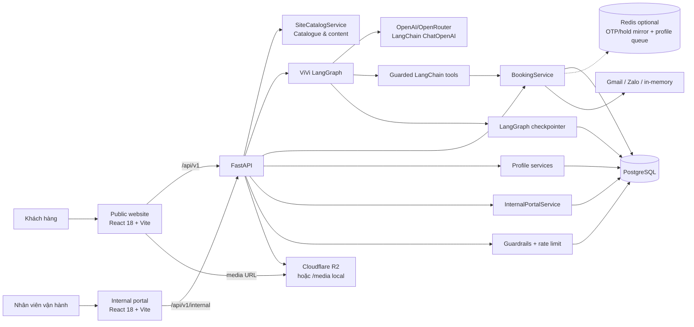
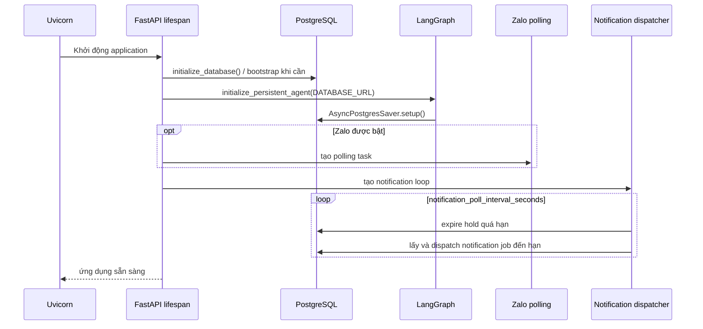
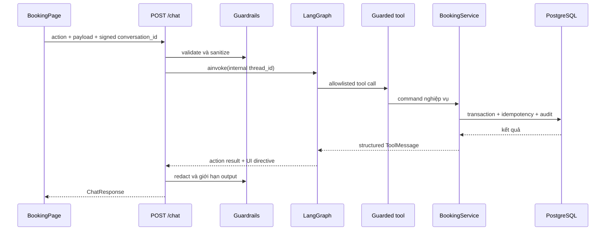
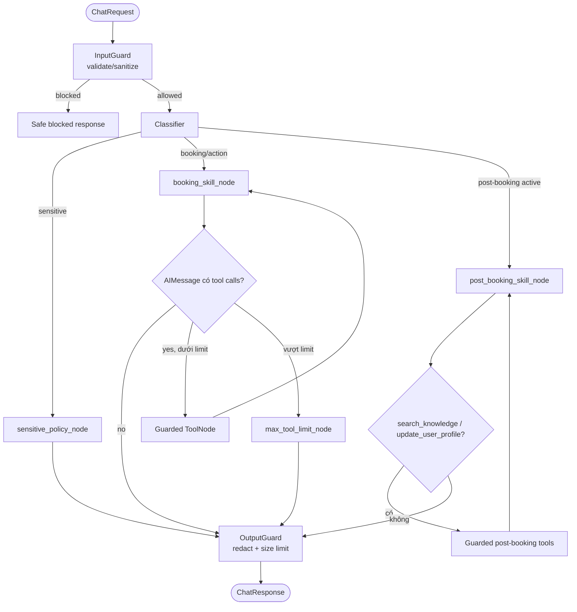

# Kiến trúc hệ thống VinFast Test Drive + ViVi

> Tài liệu mô tả implementation hiện hành trong `frontend/src`, `internal-portal/frontend/src` và `backend/src`, được đối chiếu lại với source code ngày 25-08-2026. Source code là nguồn sự thật khi có khác biệt với tài liệu.

## 1. Tổng quan

Hệ thống phục vụ hành trình tìm hiểu xe và đặt lịch lái thử VinFast, gồm website công khai, trợ lý ViVi, portal nội bộ và một FastAPI backend dùng chung.



| Loại dữ liệu | Nguồn sự thật | Ghi chú |
| --- | --- | --- |
| Catalogue/content marketing | `SiteCatalogService` | API `/vehicles`, `/content/{page}` độc lập dữ liệu booking. |
| Showroom, xe demo, slot, booking, nhân sự | PostgreSQL qua service layer | Chỉ service được thực thi nghiệp vụ và ghi DB. |
| Hồ sơ khách, booker/driver và lời mời tài xế | PostgreSQL qua profile services | Portal/admin đọc cùng dữ liệu để hỗ trợ sales. |
| Lịch sử hội thoại | LangGraph checkpoint theo internal `thread_id` | Client giữ signed conversation capability; backend xác minh rồi ánh xạ sang thread nội bộ. |
| Trạng thái UI booking | React state + `sessionStorage` | Không phải nguồn sự thật của slot/booking. |
| Token portal | `sessionStorage`; hash/revocation trong PostgreSQL | Bearer token tới API nội bộ. |
| Hold slot | PostgreSQL (`bookings`, `test_drive_slots`) | Redis chỉ là bản mirror TTL tùy chọn; transaction PostgreSQL quyết định tính đúng đắn. |

## 2. Tech stack và triển khai

| Lớp | Công nghệ đang dùng |
| --- | --- |
| Public frontend | React 18, React Router, Vite, GSAP, Three.js, Mapbox GL, `@google/model-viewer` |
| Internal frontend | React 18, Vite |
| Edge | Nginx trong Docker; Vite dev proxy |
| Backend | Python, FastAPI, Pydantic Settings, Uvicorn |
| AI | LangChain, `langchain-openai`, LangGraph, PostgreSQL checkpointer |
| Persistence | PostgreSQL 16 qua psycopg; SQLite chỉ compatibility/test |
| Cache/rate limit | Cache GET trong browser; public API rate-limit bằng counter PostgreSQL; Redis tùy chọn cho OTP/slot-hold mirror và profile-update queue |
| Messaging | Gmail OAuth, Zalo Bot/OTP, in-memory fallback |
| Media | `MEDIA_ROOT` mount tại `/media`; production có thể dùng `MEDIA_BASE_URL`/CDN |
| Container/hosting | Docker Compose local; production CI hiện dùng Cloudflare Pages, Google Cloud Run, PostgreSQL qua `DATABASE_URL` và Cloudflare R2 |

Luồng production hiện hành theo `.github/workflows` là Cloudflare Pages (public frontend và internal portal từ hai job riêng) gọi trực tiếp Google Cloud Run qua `VITE_API_BASE_URL`; Cloud Run build backend từ `backend/Dockerfile` và nhận kết nối PostgreSQL qua `DATABASE_URL`; media công khai nằm trên R2. Nginx/Vite proxy chỉ là đường chạy local/container. `docker-compose.prod.yml` vẫn mô tả một phương án self-host PostgreSQL, Redis, backend và public frontend, nhưng không phải topology được CI hiện tại triển khai.

## 3. Cấu trúc source code

```text
P-053/
├── frontend/                         # Website công khai
│   └── src/
│       ├── pages/, components/       # Trang marketing, booking và UI dùng chung
│       ├── api/                      # HTTP client, booking, catalogue adapters
│       ├── state/                    # Booking interaction state
│       └── data/, media/, styles/    # UI data, asset mapping, CSS
├── internal-portal/frontend/          # Portal vận hành và sales
├── backend/
│   ├── src/
│   │   ├── main.py                    # FastAPI, lifespan, middleware, /media
│   │   ├── api/                       # Public chat/action/site API
│   │   ├── agents/                    # Graph, state, nodes, tools, prompts, skills
│   │   ├── guardrails/                # Input/tool/output guard và contracts
│   │   ├── services/booking/          # Booking domain
│   │   ├── services/profile/          # Customer profile và driver invitation
│   │   ├── services/knowledge/        # Knowledge post-booking có provenance
│   │   ├── internal_portal/           # Auth, RBAC, operations, resources
│   │   ├── database/                  # DB adapters, schema, SQL guard, Redis
│   │   ├── security/                  # Client identity và rate limiting
│   │   └── evaluation/                # Benchmark loader, metrics và reporting
│   ├── scripts/                       # Seed/import, media, email, evaluation
│   └── tests/                         # API, agent, guardrail, booking, portal, benchmark
├── eval/                              # Dataset, schema, fixtures và báo cáo evaluation
├── docker-compose.yml
└── docker-compose.prod.yml
```

## 4. Backend architecture

### API boundary

| Nhóm | Endpoint chính | Vai trò |
| --- | --- | --- |
| Health | `GET /health`, `GET /api/v1/booking/health` | Liveness và DB/booking readiness. |
| Site | `GET /api/v1/vehicles`, `/vehicles/{id}`, `/content/{page}` | Catalogue/content; có ETag và Cache-Control. |
| Agent | `POST /api/v1/chat`, `POST /api/v1/chat/stream` | Chat hoặc structured action qua graph; SSE là wrapper của canonical chat handler. |
| Booking command | `POST /api/v1/test-drive/actions` | Command xác định trước cho lookup/update/reschedule/cancel; alias tương thích `/demo/action`. |
| Floating demo | `GET /api/v1/floating-demo/capabilities`, `POST /api/v1/floating-demo/options` | Showcase chỉ bật ngoài production; chỉ tìm availability, không có endpoint bypass để tạo booking. |
| Public invitation | `GET /api/v1/invitations/{token}` | Xác minh HMAC capability rồi resolve lịch active mới nhất theo booking code. |
| Driver/profile | `/driver-chat/*`, `/bookings/*/driver-invitation`, `/bookings/*/profile-summary.md`, `/user-profiles/*` | Chat riêng của driver, lời mời có hạn và profile hỗ trợ sales. |
| Internal | `/api/v1/internal/*` | Login, RBAC, dashboard, tài nguyên và vận hành booking. |
| Admin import | `/admin/import/*` | Chỉ `operations_admin`, chặn import security state. |

`main.py` gắn CORS, `RateLimitMiddleware`, request logging, portal error handler và static mount `/media`. Nginx proxy `/api/` và `/media/` về backend; SPA fallback xử lý React routes.

### Booking và profile domain

`BookingService` là facade ghép các mixin:

- `catalog.py`: tìm showroom/slot theo xe, địa chỉ, tọa độ, showroom và bộ lọc ngày.
- `lifecycle.py`: hold, draft, confirm và expire booking.
- `access.py`: OTP, access session, đọc lịch đã xác thực.
- `management.py`: cập nhật, đổi lịch, hủy lịch.
- `staff.py`: assignment, kiểm GPLX, check-in, complete, no-show.
- `notifications.py`, `background.py`: notification job/provider/dispatcher.
- `base.py`: transaction, audit event và idempotency.
- `public_invitation.py`: ký/xác minh public invitation bằng HMAC và resolve booking hiện hành.
- `importer.py`, `dashboard.py`, `location.py`: import, snapshot vận hành, khoảng cách.

Profile services resolve hồ sơ ẩn danh theo conversation/session, promote identity sau OTP hoặc booking, nối booker/driver với booking, tạo lời mời tài xế có hạn và cung cấp structured context/tóm tắt Markdown cho portal hoặc sales.

`KnowledgeService` tải tập tri thức post-booking có provenance, lọc theo market/model/trim/model-year/topic và trả fact kèm nguồn, review status và ranh giới dữ liệu live. Nó không thay thế catalogue hoặc inventory trong PostgreSQL.

### Startup và worker



Production fail startup nếu không khởi tạo được PostgreSQL checkpointer. Notification loop luôn chạy; Zalo polling chỉ chạy khi có đủ cấu hình/token. Profile update queue được start/stop theo lifecycle của API router.

## 5. Luồng frontend – backend

### Website công khai

`App.jsx` quản lý các trang marketing, chi tiết xe và booking. `BackendStatusProvider` kiểm tra `/api/v1/booking/health`; `api/client.js` dùng base URL `/api/v1`, cache GET trong RAM + `If-None-Match`, POST JSON không cache và chuẩn hóa lỗi thành `ApiError`.

`BookingPage.jsx` là orchestration component của booking UI. State machine chuẩn nằm ở `state/bookingInteraction.js`, gồm bốn mode (`idle`, `vehicle_browse`, `new_booking`, `manage_booking`) và các phase chọn xe/vị trí/showroom/slot, nhập thông tin, review, success, OTP, danh sách booking và reschedule. Lớp ánh xạ legacy stage vẫn được giữ để tương thích UI hiện tại. State được serialize vào `sessionStorage` để resume trải nghiệm, nhưng không có quyền quyết định availability hoặc trạng thái terminal của booking.

### Đặt lịch mới qua structured action

`search_options` phân biệt vị trí khách (`address` hoặc GPS) với tên/mã showroom (`showroom_query`). Vùng quá rộng trả `location_clarification`; candidate chỉ được trả khi showroom, demo vehicle, pin và slot đều khả dụng trong cửa sổ đặt lịch cấu hình được.

Ba contract ngày loại trừ nhau gồm `preferred_date`, `preferred_dates`, và `preferred_date_from` + `preferred_date_to`. Service query inventory thật và trả `available_dates`/`highlighted_dates`; frontend không tự suy diễn inventory.



`ui_action_id` và hash payload cho phép replay an toàn; `expected_version` bảo vệ optimistic concurrency khi update/confirm draft. `confirm_test_drive_booking` chỉ được chạy từ structured confirmation đã bind đúng payload, không được mở cho free-form LLM.

### Hold slot và xác nhận

Hold có TTL cố định 300 giây. `LifecycleService.hold_slot()` mở transaction, khóa dòng `test_drive_slots` bằng `FOR UPDATE` trên PostgreSQL, rồi kiểm tra:

- slot còn `available`, chưa bắt đầu và nằm trong booking window;
- demo vehicle active, operational status `available`, pin đạt `minimum_booking_soc`;
- không có slot `booked`, `blocked` hoặc hold còn hiệu lực bị trùng trên cùng xe.

Sau đó service tạo một booking `held`, ghi `hold_expires_at`, chuyển slot sang `held`, gắn `current_booking_id`, tạo driver-detail/notification-plan và audit event. Redis nhận một bản mirror TTL nếu được bật, nhưng PostgreSQL vẫn là authority. Hai request cạnh tranh cùng slot được serialize bởi row lock; request đến sau thấy slot không còn available.

Hold được giải phóng theo ba đường: người dùng gọi `release_hold`, một request hold mới lazy-expire hold cũ, hoặc background loop gọi `expire_held_bookings()` với `FOR UPDATE SKIP LOCKED`. Frontend đếm ngược theo `hold_expires_at`; đồng hồ client chỉ là UX. Khi confirm, service kiểm tra lại hold, slot ownership, thời gian bắt đầu, vehicle readiness, pin, draft completeness và `expected_version` trước khi chuyển booking sang `confirmed` và slot sang `booked`.

### Tra cứu, sửa, dời hoặc hủy booking

Nhóm này đi qua `/test-drive/actions`, không cần LLM. Form quản lý dùng email bắt buộc và mã lịch tùy chọn: có mã thì sau OTP mở thẳng booking đã được đối chiếu email; không có mã thì trả các booking cùng contact, tự mở nếu chỉ có một hoặc yêu cầu chọn khi có nhiều. Khách phải xác thực OTP để nhận access session token; service kiểm permission và owner trước mỗi command. Portal dùng opaque bearer session, RBAC và showroom scope riêng.

Reschedule được thực hiện bằng cách hold một slot mới thành draft booking, sau đó confirm chuyển lịch và giữ booking code theo chuỗi lịch hiện hành. Cancel/reschedule chỉ áp dụng cho trạng thái được phép và đều ghi audit/idempotency. Access session mang permission theo purpose; xác thực OTP không tự cấp mọi quyền quản lý.

Với yêu cầu đổi lịch qua chat, classifier chỉ trích xuất biểu thức thời gian có cấu trúc (`explicit`, `relative_to_today`, `relative_to_booking`, hoặc `ambiguous`) và giờ địa phương 24h. Sau OTP, `ManagementService.search_reschedule_options()` mới resolve ngày theo timezone của showroom, truy vấn inventory đúng ngày và áp dụng policy: chỉ auto-hold khi khớp chính xác hoặc lệch tối đa 60 phút; lệch xa, thiếu dữ kiện hoặc hết slot trong ngày đều yêu cầu người dùng chọn/xác nhận và không tự chuyển sang ngày khác. Frontend không parse ngôn ngữ hay tự xếp hạng slot; pending intent chỉ được lưu trong `sessionStorage` để phục hồi UX và không có quyền quyết định inventory.

### Profile, người đặt và người lái

Mỗi booking có thể có hai `people`: booker và driver. Nếu đặt hộ, frontend gửi contact của driver riêng thay vì tự sao chép contact của booker. Sau confirm, profile ẩn danh được promote từ booking; sau OTP, profile được promote từ verified identity. Driver invitation dùng token ngẫu nhiên chỉ lưu hash trong DB, revoke lời mời active cũ, có TTL và chỉ resolve khi driver vẫn gắn với booking `confirmed`/`checked_in`.

Public invitation dùng capability HMAC chứa booking code; backend không nhận booking code thô từ URL. Khi resolve, service chỉ trả booking ở trạng thái `confirmed`, `checked_in`, `completed` hoặc `no_show`, vì vậy thiệp tự mất hiệu lực nếu lịch bị hủy.

## 6. Luồng LangChain/LangGraph của ViVi

- `classifier_node.py`: keyword fast-path, LLM structured route và fallback.
- `booking_skill_node.py`: structured action hoặc free chat với bound tools.
- `sensitive_policy_node.py`: policy response, không gọi tool.
- `post_booking_skill_node.py`: tư vấn sau booking bằng knowledge có provenance và cập nhật profile có kiểm soát.
- `tool_guard.py`: allowlist, payload contract, confirmation binding và safe error serialization.
- `UsageBudgetService`: giới hạn cost/call theo ngày và session.



UI context được đưa vào LLM như dữ liệu tham chiếu không đáng tin cậy, không nối vào system role. Tool result cũng được bọc như untrusted content trước khi quay lại model. Khi hỏi availability và UI đã có xe/showroom, tool search được ép gọi để tránh trả lời từ memory.

Graph có checkpointer theo `thread_id`: local/test hoặc database không phải PostgreSQL dùng `MemorySaver`; production yêu cầu `AsyncPostgresSaver` và fail startup nếu không khởi tạo được. Budget tool loop được reset mỗi user turn và giới hạn 8 call cho booking; mỗi skill có ToolNode/allowlist riêng nên tool của post-booking không thể tự chạy trong booking skill và ngược lại.

Structured action vẫn đi qua graph nhưng bỏ qua bước LLM sinh tool call: `booking_skill_node` ánh xạ action sang tool và tạo stable tool-call ID từ hash canonical payload. Free-form chat mới cần model. Riêng confirm tool không nằm trong danh sách tool bind cho free-form LLM; ToolGuard còn yêu cầu exact structured confirmation gồm action và payload khớp.

`POST /api/v1/chat/stream` (alias `/api/v1/booking-agent/stream`) gọi trực tiếp canonical chat handler để dùng lại conversation verification, abuse check, profile context và guardrails; response đã bảo vệ được chia thành SSE `token` events rồi kết thúc bằng event `done`. Hai path stream chưa được `RateLimitMiddleware.route_class_for_path()` phân loại, nên hiện không tiêu thụ bucket rate-limit của `/api/v1/chat`.

## 7. Bảo mật, tin cậy và quan sát

- Signed conversation capability có TTL; token sửa/hết hạn được thay bằng thread cô lập mới và không dùng trực tiếp làm checkpoint key.
- Input guard giới hạn size/depth/node/string, kiểm allowlist context/action, normalize Unicode và chặn injection/abuse.
- Vi phạm injection hoặc abusive language tích lũy strike theo signed conversation/anonymous session; đạt ngưỡng sẽ bị ban có `Retry-After`. Raw proxy IP không được dùng cho ban 24 giờ.
- Tool guard chỉ cho tool đăng ký, chặn duplicate/batch mutation trái policy và bind confirmation với UI action.
- Output guard loại internal analysis, redact credential/OTP/contact và giới hạn kích thước response/action data.
- `RateLimitMiddleware` dùng anonymous HttpOnly cookie + IP, lưu fixed-window counters atomically trong PostgreSQL cho chat, deterministic action và public invitation. OTP có counter riêng theo contact/challenge; abuse tracker dùng signed conversation/internal thread và anonymous session.
- OTP có TTL, cooldown, số lần thử tối đa, pepper server-side; production không trả mock OTP.
- Mutation booking dùng transaction, version check, idempotency và audit event.
- Trace/log redact request, LLM và tool data; HTTP middleware ghi status/latency.
- Production yêu cầu secret OTP đủ mạnh và conversation signing secret; development thiếu secret sẽ phát cảnh báo startup. Public invitation dùng HMAC domain-separated; driver invitation dùng random bearer token nhưng DB chỉ lưu SHA-256 hash.
- Floating demo luôn báo disabled trong production và chỉ có API search availability. Các endpoint bypass tạo booking demo đã bị loại bỏ; mọi mutation vẫn đi qua contract và service chuẩn.

### Internal Portal và RBAC

Internal Portal lưu opaque bearer token trong `sessionStorage`; backend chỉ lưu token hash, expiry và trạng thái revoke. Ba role là `staff`, `showroom_manager`, `operations_admin`. Service kiểm role và showroom scope trước khi trả dữ liệu hoặc mutation. Các capability chính gồm dashboard, notification, booking detail/assignment/transition, GPLX/check-in/complete/no-show/cancel, staff/shift/unavailability, showroom operating hours, fleet/unavailability/transfer, catalogue, user và audit event.

Import public không tồn tại. Hai API `/admin/import/*` phụ thuộc principal `operations_admin`, đồng thời từ chối các file chứa user, session, OTP, access-token, idempotency hoặc audit security state.

### Failure handling và consistency

- GET catalogue dùng ETag; frontend có memory cache và chỉ fallback cache khi caller cho phép.
- POST không cache và chuẩn hóa lỗi thành `ApiError`; booking error trả code/retryable ổn định.
- Notification được ghi thành job trong cùng transaction nghiệp vụ rồi background dispatcher xử lý; retry không làm thay đổi booking đã commit.
- Profile lookup/promotion lỗi được log và không làm hỏng canonical booking response.
- SSE không stream trực tiếp token thô từ model: nó gọi canonical `/chat`, bảo vệ output hoàn chỉnh, rồi chia response an toàn thành event `token` và `done`.

## 8. Benchmark và kiểm thử

Benchmark agent nằm trong `backend/src/evaluation`, dataset/report trong `eval/` và entrypoint ở `backend/scripts/run_agent_evaluation.py`. Schema benchmark 1.1 bắt buộc coverage tối thiểu theo category; CI chạy correctness/security/latency metrics cùng mutation tests cho injection detection, output sanitization, confirmation binding, conversation verification, rate limiting và abuse threshold.

Test suite được chia theo boundary (`test_api`, `test_services`, `test_guardrails`, `test_security`, `test_internal_portal`, `test_tools`) và có các case concurrency/idempotency cho search-hold, draft-confirm, management, OTP, notification và staff operations. Frontend CI build public app và internal portal; workflow production deploy hai frontend lên Cloudflare Pages. Backend CI chạy Ruff, Mypy, Bandit, benchmark, Pytest/coverage và Docker build trước khi deploy source lên Google Cloud Run.

Các thay đổi booking/agent cần chạy unit/integration tests, benchmark, Ruff và frontend checks tương ứng trước khi merge.

## 9. Giới hạn hiện tại và technical debt

- `BookingPage.jsx` vẫn là orchestration component lớn và giữ song song state machine mới với legacy stage mapping; nên tách workflow/hook trước khi mở rộng đáng kể.
- `advise_skill_node.py` còn tồn tại trong source nhưng không được `graph.py` đăng ký; nhánh tư vấn active hiện là `post_booking_skill_node.py`.
- Hai endpoint SSE chưa nằm trong route-class của public rate limiter như `/api/v1/chat`; guardrail/abuse vẫn chạy nhưng request quota middleware chưa tương đương.
- Các route tạo driver invitation và đọc profile summary/detail trong `api/routes.py` hiện không có dependency auth/RBAC. Chúng dựa vào identifier/token ở request và cần được đặt sau authorization boundary trước khi coi là API production cho dữ liệu riêng tư.
- `update_user_profile` phụ thuộc Redis profile queue; khi Redis không available, tool trả trạng thái `unavailable` và signal không được persist. Booking, slot và public rate-limit vẫn dựa vào PostgreSQL.
- `/media` local vẫn luôn được mount khi backend khởi động, trong khi production frontend thường đọc R2 qua `VITE_MEDIA_BASE_URL`; hai đường media cần giữ key mapping nhất quán.

## 10. Quy ước mở rộng

1. Production cần PostgreSQL vì conversation memory/checkpointer là bắt buộc.
2. Redis có thể tắt bằng `REDIS_ENABLED=false`; rate-limit production vẫn cần cấu hình datastore phù hợp.
3. Không đưa secret `.env`, Gmail refresh token, Zalo token hay OTP secret vào source/trace.
4. Thêm booking action: cập nhật DTO/guardrail contract → frontend API → action map/tool → service/tests → UI directive.
5. Thêm LangGraph tool: cập nhật export, graph list, ToolNode allowlist, policy/contracts và security tests.
6. Thêm dữ liệu hồ sơ: xác định nguồn tin cậy, consent/scope hiển thị, redaction và audit trước khi đưa vào context cho agent hoặc sales.
7. Không dùng frontend countdown, Redis TTL hoặc LLM response làm authority cho slot; mọi quyết định hold/confirm phải quay lại PostgreSQL transaction.
8. Không thêm mutation vào floating demo hoặc public invitation; các bề mặt này chỉ được expose capability/read/search theo contract hiện tại.
9. Thêm nội dung post-booking phải có provenance, scope và review status; dữ liệu live như giá, availability hoặc chính sách thay đổi không được suy ra từ knowledge snapshot.
