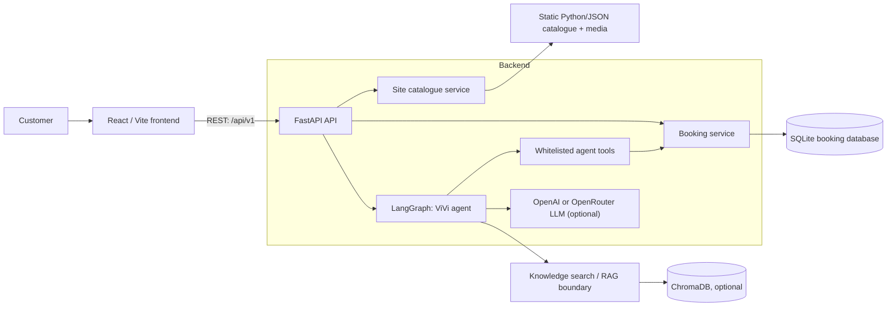
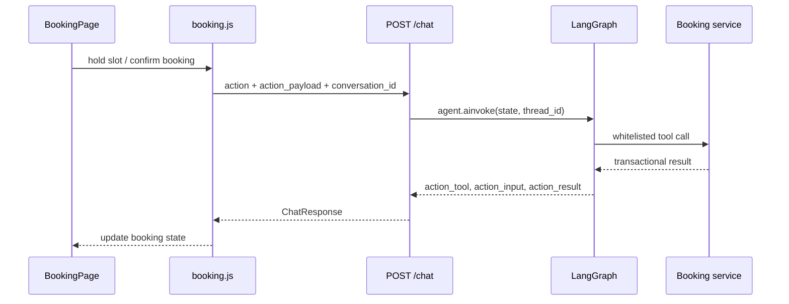
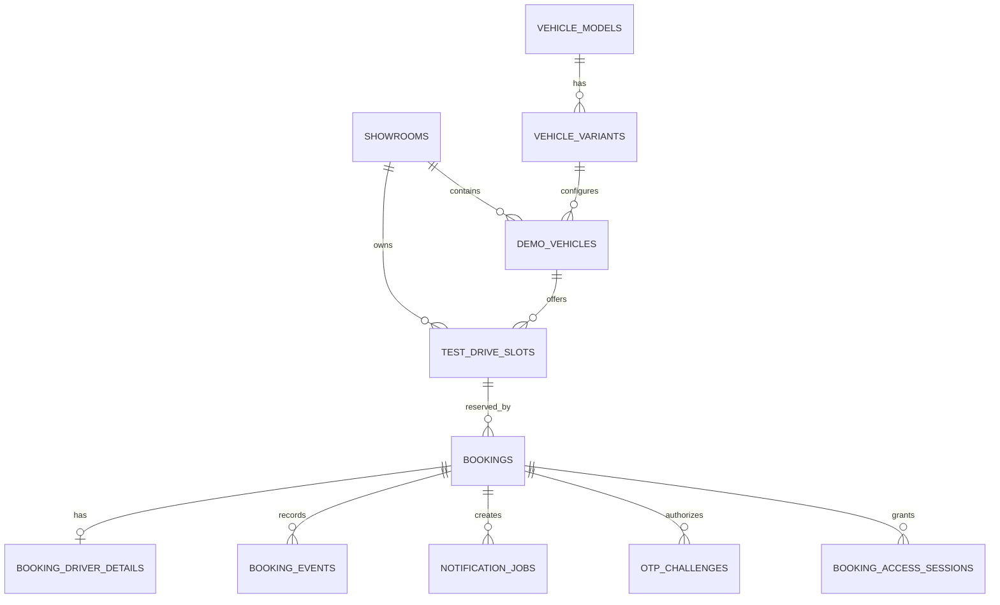
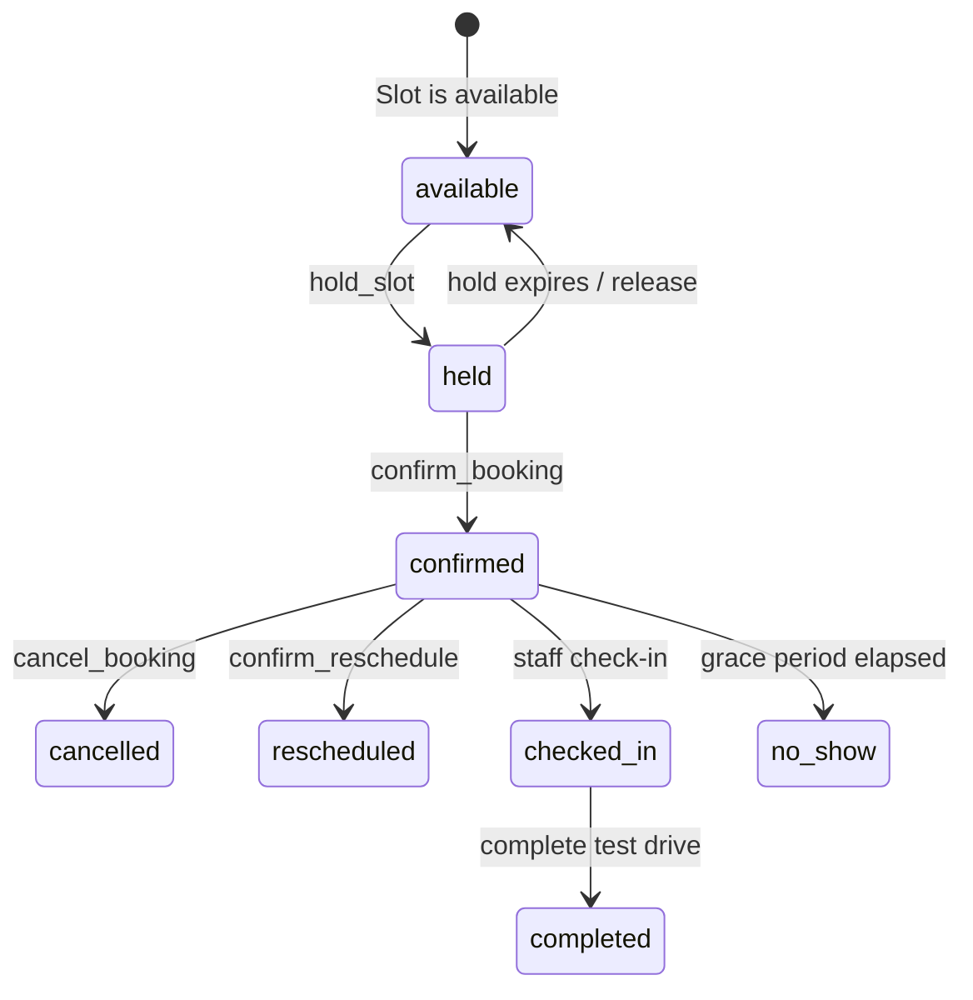
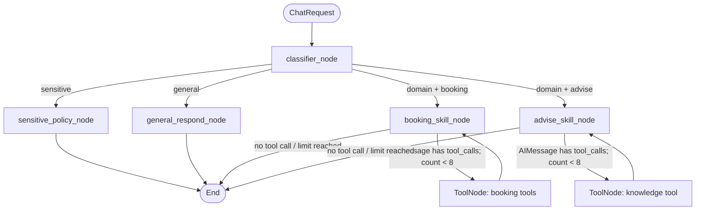

# VinFast Test Drive Platform — Architecture

## 1. Purpose and current scope

This repository implements a VinFast catalogue and test-drive booking experience. It has two complementary interaction paths:

1. The React user interface provides deterministic flows for browsing vehicles, choosing a showroom/slot, entering customer details, and confirming a booking.
2. ViVi, a LangGraph agent, accepts natural-language requests and may call the same booking capabilities through an explicit, whitelisted tool set.

The system is intentionally a development/MVP architecture. SQLite is the system of record for booking data; notification delivery is a mock adapter; catalogue and content are read-only snapshots served by the backend. The AI model is optional: the non-AI catalogue and deterministic booking endpoints continue to function when no model key is configured.

## 2. High-level architecture



### Runtime boundaries

| Layer | Responsibility | Does it mutate booking data? |
| --- | --- | --- |
| React frontend | UI state, request orchestration, rendering API data | No, except by calling backend commands |
| FastAPI | HTTP validation, API responses, health, imports and observability | Only through service calls |
| LangGraph | Intent routing, safety policy, tool orchestration | Only through whitelisted tools |
| Booking service | Transactional domain rules and idempotency | Yes |
| SQLite | Durable booking, slots, access, notifications and event records | Yes |
| Site catalogue service | Read-only vehicle/content DTOs, media URLs and ETags | No |

## 3. Frontend architecture

The frontend is a React application built by Vite. It uses route/page components for the public VinFast site and a booking page that combines a chat panel with deterministic booking controls.

### Main frontend responsibilities

- Fetch site data through `src/api/content.js`, `vehicles.js`, and adapter functions in `src/api/adapters.js`.
- Preserve the ViVi conversation ID in `sessionStorage` (`vinfast:booking-conversation-id`) so related chat turns use the same LangGraph thread.
- Keep local booking UI state: selected vehicle, showroom, slot, held booking ID/version, customer form data, confirmation state, and UI messages.
- Convert backend catalogue DTOs to component-friendly objects. The backend is authoritative; the adapter is a display mapping, not a second source of truth.
- Display a recoverable backend error rather than assuming a booking command completed.

### Booking UI and agent action client

`frontend/src/api/booking.js` is the bridge from UI to `POST /api/v1/chat`:



#### Retry-safe UI actions

Side-effecting UI commands use a client-generated `ui_action_id`:

- Slot hold: `hold:<UUID>`
- Booking confirmation: `confirm:<UUID>`

`BookingPage` stores these IDs in refs keyed by the slot or booking/version. A network failure leaves the ID in place, so retrying the same visible action sends the same ID. On success, the ID is cleared. This is important because an uncertain network response must not create a second hold or confirmation.

## 4. FastAPI application

The application entry point is `backend/src/main.py`.

### Application lifecycle

1. Read settings from root `.env` or backend `.env`.
2. Configure logging during the FastAPI lifespan startup hook.
3. Configure CORS from `CORS_ORIGINS`.
4. Mount routers under `/api/v1` and mount local development media at `/media`.
5. Add request logging with method, path, status code and elapsed time.

### Important API groups

| Endpoint group | Function |
| --- | --- |
| `/api/v1/chat` | Main ViVi chat and structured-agent action entry point |
| `/api/v1/vehicles`, `/content/*` | Read-only site catalogue/content endpoints with ETag support |
| `/api/v1/demo/action` | Deterministic command simulator for booking/demo workflows |
| `/api/v1/dashboard` | Read-only booking operational snapshot |
| `/api/v1/admin/import/*` | CSV showroom and evaluation dataset imports |
| `/api/v1/client-log` | Sanitised frontend observability logging |
| `/health` | Container/service health check |

`ChatRequest` includes a user message, optional conversation ID, UI context, optional `action`, and `action_payload`. The route creates a conversation ID when absent and passes it as the LangGraph `thread_id`. The response exposes only the user-safe response plus structured action telemetry (`tool_name`, `tool_input`, `action_data`, `action_error`) needed by the UI.

## 5. Booking domain and persistence

`BookingService` composes focused service modules over one SQLite database. Database connections enable foreign keys, WAL mode, a busy timeout and explicit immediate transactions for command paths.

### Core data model



### Booking state lifecycle



Key invariants are enforced inside the booking service, not trusted to the UI:

- A slot must be available, future-dated and assigned to an active, operational vehicle with sufficient battery.
- A hold lasts 900 seconds.
- Confirmation validates the held draft, expected version, and current slot state.
- Booking lookup/change actions use OTP-backed access sessions and action-specific permissions.
- Database transactions prevent competing holds from both succeeding.
- Booking events and notification jobs are created transactionally with the booking transition.

### Idempotency

Every side-effecting booking command requires a namespaced `ui_action_id`, for example `hold:*` or `confirm:*`. The service stores the request hash and response in `idempotency_records` inside the same transaction. Replaying an identical action returns the original result; reusing the ID for a different operation or payload produces an idempotency conflict.

This protection exists at two layers:

1. The frontend keeps the same action ID during a retry.
2. The database service persists and validates the ID across requests/process restarts.

## 6. Showroom and availability search

`CatalogService.search_options()` is the entry point for the booking search flow.

1. Resolve the requested vehicle model and optional variant.
2. If no showroom is selected, return eligible showrooms for the vehicle.
3. If an address is supplied, rank showrooms by locality-token overlap.
4. If coordinates are supplied, compute distance using the Haversine map provider and sort nearest first.
5. If a showroom is selected, return future, available slots for that showroom and vehicle variant.

Address matching does not use a remote geocoder. Vietnamese locality tokens are normalized by case folding, diacritic removal and stop-word removal. Showroom name/address tokens are cached by showroom identity and `updated_at`; a request only tokenizes the user input and intersects it with cached showroom tokens. This avoids repeating Unicode normalization/tokenization for every showroom on every search while still refreshing automatically after showroom data changes.

For a large production showroom network, replace or complement this in-process cache with a database full-text index or a persisted normalized search column.

## 7. ViVi AI Agent architecture

The agent is compiled in `backend/src/agents/graph.py` with a `MemorySaver` checkpointer. Message history is kept per API `conversation_id`/LangGraph `thread_id`.



### Agent state

The graph state contains query/context, messages, intent, active skill, response/error fields, a `tool_call_count`, and structured action fields. `messages` uses LangGraph's `add_messages` reducer so the conversation and tool results can be correlated. The checkpoint may retain the full thread, but model invocations receive a recent window of at most 24 messages. The window keeps each `AIMessage` tool call together with its matching `ToolMessage`; it never truncates a tool result away from the command that produced it.

The graph has a maximum of eight tool-call iterations to prevent uncontrolled model/tool loops.

### Routing and fallback

1. **Classifier**: immediately routes a structured UI action or booking-channel request to booking; otherwise it applies sensitive/out-of-scope keyword checks and uses a structured LLM classifier.
2. **Sensitive policy**: returns the policy-safe response without calling domain tools.
3. **General response**: handles greetings with an LLM when configured, otherwise returns a deterministic Vietnamese greeting.
4. **Booking skill**: binds only booking tools and applies the booking skill instructions.
5. **Advise skill**: binds only `search_knowledge`.

No API key is fabricated. `get_llm()` and `get_classifier_llm()` return `None` when neither `OPENROUTER_API_KEY` nor `OPENAI_API_KEY` is configured. Nodes handle that explicitly: classifier uses its keyword fallback, general returns a deterministic greeting, and domain skills return a safe model-unavailable response. The process still starts and deterministic UI APIs remain available.

### Tool allowlists

| Skill | Tools |
| --- | --- |
| Booking | `search_test_drive_options`, `hold_test_drive_slot`, `get_booking_draft`, `update_booking_draft`, `request_booking_access`, `verify_booking_access`, `get_booking_details`, `confirm_test_drive_booking` |
| Advise | `search_knowledge` |

The graph uses separate `ToolNode` instances for booking and advice. A model cannot reach booking tools through the advice loop.

### Structured UI actions

The UI can pass a confirmed action (`search_options`, `hold_slot`, `update_draft`, or `confirm_booking`) rather than asking the model to infer an action from text. `booking_skill_node` maps the action to its allowlisted tool and creates an `AIMessage` tool call.

For a given action and canonical JSON payload, the generated LangChain tool-call ID is deterministic (SHA-256 derived), rather than random. A graph retry therefore represents the same tool command and preserves correlation with the corresponding `ToolMessage`. The persisted `ui_action_id` remains the final authority for booking idempotency.

## 8. Configuration and deployment

Important configuration values:

| Variable | Purpose |
| --- | --- |
| `DATABASE_URL` | SQLite URL for the MVP database |
| `OPENAI_API_KEY` | Direct OpenAI provider key |
| `OPENROUTER_API_KEY` | OpenRouter provider key; takes precedence when present |
| `MODEL_NAME` | Chat model name |
| `CLASSIFIER_MODEL_NAME` | Optional model dedicated to intent classification |
| `CORS_ORIGINS` | Comma-separated frontend origins |
| `MEDIA_ROOT`, `MEDIA_BASE_URL` | Local media storage and public URL prefix |
| `SITE_CATALOG_PATH` | Optional validated catalogue snapshot override |

`docker-compose.yml` runs the backend on port 8000 and frontend on port 3000. The backend container persists `backend/data` as a volume and exposes `/health` for Docker health checks.

## 9. Observability, privacy and AI usage logs

- Backend logs are configured centrally and include HTTP timing plus server-side exceptions.
- `/client-log` removes sensitive fields such as OTP codes, access tokens and contact values before logging frontend events.
- Booking service events provide a durable business audit trail separate from application logs.
- Project AI-tool hooks write local JSONL usage records under `.ai-log/`; the pre-push hook scans both Codex Desktop and Antigravity sessions, recovers interrupted pending batches, then submits entries to the configured AI-log server.
- Prompt logging must not contain raw PII. The intended production rule is to redact user personal data before analytics/observability sinks.

## 10. Known MVP boundaries and production next steps

1. **SQLite and in-memory graph checkpointing**: suitable for one-process development. Use PostgreSQL and a durable LangGraph checkpointer for multi-instance production.
2. **Knowledge retrieval**: the RAG boundary and Chroma persistence exist, but knowledge quality depends on the indexed corpus and ingestion pipeline. Treat it as optional until an evaluated corpus is deployed.
3. **Notifications**: current delivery is a mock adapter. Integrate an approved SMS/email/Zalo provider with retry, provider receipts and secrets management before real customer use.
4. **Showroom search**: in-memory token caching is efficient for an MVP; add full-text search/geocoding infrastructure for a nationwide dataset.
5. **Media/catalogue**: catalogue is read-only snapshot data. A production CMS/inventory integration needs explicit publish validation, cache invalidation and asset lifecycle ownership.
6. **Agent operations**: retain tool allowlists and idempotency checks; add tracing, prompt/version management, model evaluation and provider fallback before relying on the agent for critical flows.

## 11. Verification guidance

Suggested checks after changes:

```bash
# Frontend production build
cd frontend
npm run build

# Backend test suite (with a working Python environment)
cd ../backend
python -m pytest -q
```

Test coverage should include booking state transitions, concurrent holds, idempotent replays, access-control checks, tool allowlists, classifier fallback, deterministic structured tool-call IDs, and showroom token-cache invalidation.
