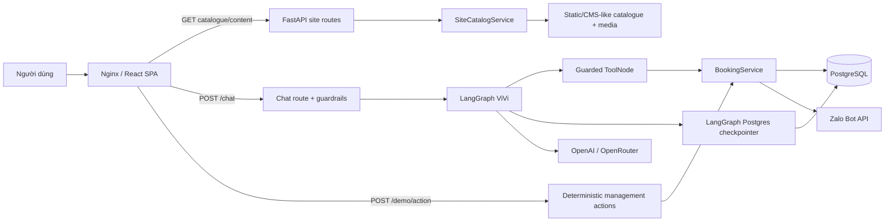
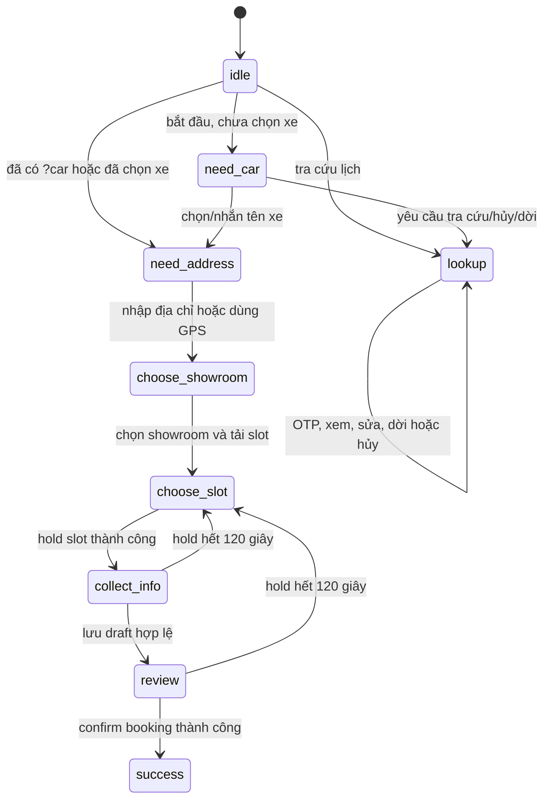
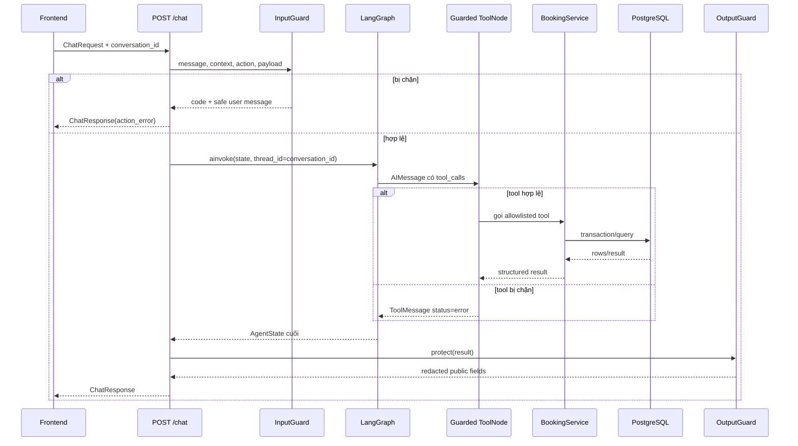
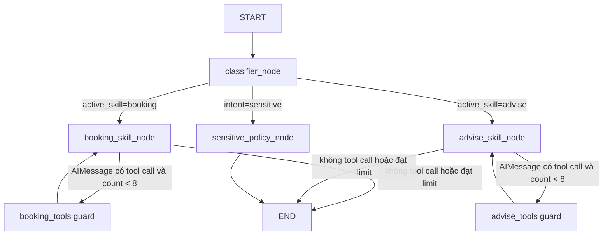
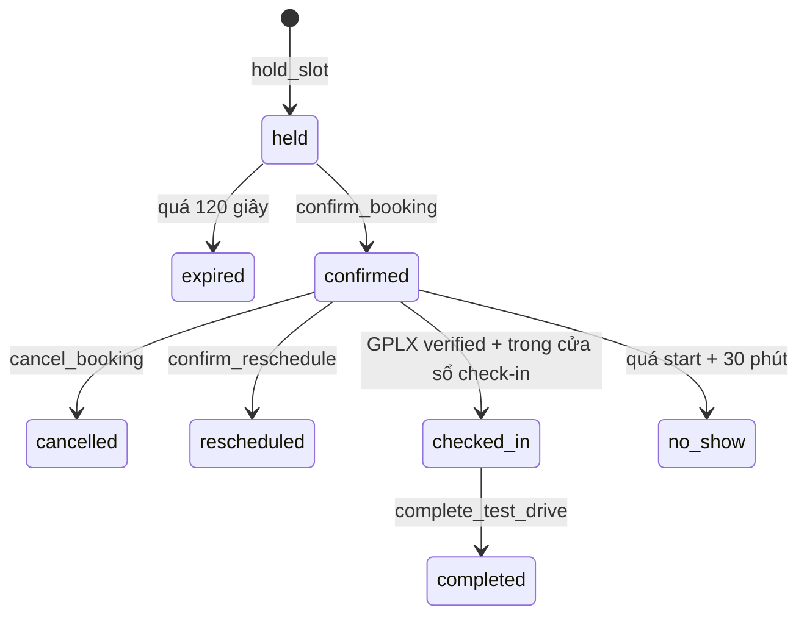

# Kiến trúc hệ thống VinFast Test Drive + ViVi

> Tài liệu này mô tả source code hiện tại trong `frontend/src` và `backend/src` tại ngày 2026-08-10. Code đang chạy là nguồn sự thật cuối cùng nếu tài liệu và implementation lệch nhau.

## 1. Phạm vi và mô hình tổng thể

Ứng dụng gồm hai phần:

- Website React/Vite giới thiệu xe, nội dung hậu mãi, trạm sạc và giao diện đặt/tra cứu lịch lái thử.
- FastAPI backend cung cấp catalogue, điều phối LangGraph agent ViVi, thực thi nghiệp vụ booking, OTP Zalo, notification và lưu dữ liệu vào PostgreSQL.

ViVi không ghi SQL trực tiếp. Node LangGraph chỉ tạo tool call; tool gọi `BookingService`; service mới kiểm tra nghiệp vụ và thao tác database trong transaction.



### Các nguồn dữ liệu khác nhau

| Dữ liệu | Nguồn hiện tại | Ghi chú |
| --- | --- | --- |
| Catalogue marketing, trang home/charging/after-sales | `SiteCatalogService` trong memory, có thể import snapshot JSON | Không lấy từ bảng booking |
| Model/variant/showroom/demo vehicle/slot/booking | PostgreSQL qua `BookingService` | Nguồn sự thật cho lịch lái thử |
| Context hội thoại LangGraph | PostgreSQL checkpointer theo `thread_id` | `conversation_id` của frontend chính là `thread_id` |
| Trạng thái giao diện booking | React state + `sessionStorage` | Không phải nguồn sự thật về slot/booking |
| Media frontend | asset bundle và `/media` backend/CDN | Adapter frontend đổi URL khi cần |

## 2. Cấu trúc source

### 2.1 Backend

```text
backend/src/
├── main.py                     # FastAPI app, lifespan, middleware, background loops
├── config.py                   # Pydantic settings từ environment
├── dependencies.py             # Singleton Database, BookingService, Zalo adapters
├── bootstrap.py                # Tạo schema và auto-import eval data khi DB rỗng
├── logging_config.py           # Console/file log configuration
├── api/
│   ├── routes.py               # Chat, booking actions, import, dashboard, client log
│   └── site_routes.py          # Catalogue xe và nội dung website, ETag/cache
├── agents/
│   ├── graph.py                # Khai báo LangGraph, routing, checkpointer lifecycle
│   ├── state.py                # AgentState
│   ├── constants.py            # Sensitive/out-of-scope keyword lists
│   ├── utils.py                # System prompt và cửa sổ message history
│   ├── trace.py                # AI trace có redaction
│   ├── nodes/                  # classifier, sensitive, advise, booking
│   ├── tools/                  # LangChain tools gọi BookingService
│   ├── prompts/                # System prompt chung
│   └── skills/                 # Prompt hướng dẫn riêng cho booking/advise
├── guardrails/
│   ├── input_guard.py          # Kiểm tra message/context/action trước graph
│   ├── tool_guard.py           # Allowlist và policy trước khi tool chạy
│   ├── output_guard.py         # Redact và giới hạn response public
│   ├── policies.py             # Contracts, pattern và danh sách tool mutation
│   ├── structure.py            # Giới hạn kích thước/độ sâu payload
│   └── pipeline.py             # Facade Guardrails dùng tại API
├── services/
│   ├── llm.py                  # Chọn OpenRouter/OpenAI hoặc trả None
│   ├── site_catalog.py         # Catalogue/content marketing
│   ├── zalo_bot.py             # Zalo client, OTP sender và polling link tài khoản
│   └── booking/
│       ├── service.py          # BookingService ghép các service mixin
│       ├── base.py             # Event audit và idempotency
│       ├── catalog.py          # Model/showroom/slot search
│       ├── lifecycle.py        # Hold, draft, confirm, expire
│       ├── access.py           # OTP, access session, read/list booking
│       ├── management.py       # Update, reschedule, cancel
│       ├── staff.py            # GPLX, check-in, complete, no-show
│       ├── background.py       # Gửi notification jobs
│       ├── notifications.py    # Provider interfaces/adapters
│       ├── importer.py         # Import showroom/eval CSV
│       ├── dashboard.py        # Operational snapshot
│       ├── location.py         # Haversine distance
│       └── common.py/errors.py # Helpers và BookingError
├── database/
│   ├── __init__.py             # Database facade chọn adapter
│   ├── postgres.py             # psycopg adapter
│   ├── sqlite.py               # Legacy/test adapter còn nằm trong source
│   ├── schema.py               # Metadata bảng + DDL
│   ├── guard.py                # Kiểm tra table/column/placeholder SQL
│   └── rows.py/errors.py       # Row wrapper và integrity error
└── models/
    ├── schemas.py              # Chat/action request-response DTO
    └── site.py                 # Catalogue/content DTO
```

### 2.2 Frontend

```text
frontend/src/
├── main.jsx                    # React entry, font, global CSS, error boundary
├── App.jsx                     # BrowserRouter, backend gate, route effects
├── pages/
│   ├── HomePage.jsx            # Landing page + catalogue + animation
│   ├── CarDetailPage.jsx       # Chi tiết xe, media, màu, 3D, CTA booking
│   ├── BookingPage.jsx         # Booking state machine, chat và quản lý lịch
│   ├── ChargingPage.jsx        # Pin/trạm sạc
│   └── AfterSalesPage.jsx      # Hậu mãi/bảo hành
├── api/
│   ├── client.js               # Base URL, fetch, GET cache/ETag, ApiError
│   ├── booking.js              # Chat, create booking và management actions
│   ├── vehicles.js             # Catalogue vehicle requests
│   ├── content.js              # Page content requests
│   ├── availability.js         # Backend booking health request
│   ├── adapters.js             # Backend DTO -> UI car model
│   └── ids.js                  # UUID và idempotent ui_action_id
├── context/
│   └── BackendStatusContext.jsx # Health poll 30 giây + online/offline
├── hooks/
│   └── useSiteData.js          # Catalogue/detail/content hooks + AbortController
├── components/
│   ├── AppShell.jsx            # Header/menu/backend warning cho marketing pages
│   ├── Vehicle3DExperience.jsx # Three.js/GLB experience
│   ├── home/                   # Các section Lạc Hồng
│   └── booking/                # OTP, form, calendar, ticket, map, modal
├── data/                       # Cấu hình UI/static editorial hỗ trợ
└── media/                      # Asset resolver, local images/video/GLB/PDF
```

`BookingPage.jsx` hiện chứa cả state machine và một số component map/vehicle riêng. Trong `components/booking/VehicleWorkspace.jsx`, `VehicleSwitcher` và `VehiclePanel` là bản không được `BookingPage` sử dụng; chỉ `VehicleShot` còn được dùng bởi các component khác.

## 3. Runtime và lifecycle backend

Khi Uvicorn import app, `dependencies.py` tạo các singleton theo settings:

1. `Database(settings.database_url)`.
2. `ZaloBotClient` nếu Zalo được bật và có token.
3. `ZaloOtpSender` nếu có Zalo client.
4. `BookingService` dùng database, OTP sender và `RoutingMessagingProvider`.

FastAPI lifespan trong `main.py` chạy theo thứ tự:

1. Đọc settings và cấu hình logging.
2. `initialize_database()` tạo/migrate schema nghiệp vụ.
3. Nếu `AUTO_LOAD_EVAL_DATA=true` và các bảng lõi đều rỗng, import dataset từ `EVAL_DATA_DIR`.
4. Khởi tạo LangGraph checkpointer:
   - PostgreSQL URL: tạo `AsyncPostgresSaver`, gọi `setup()` và compile graph bằng saver này.
   - URL không phải PostgreSQL: dùng graph mặc định với `MemorySaver`; đây là compatibility path, không phải datastore production hiện tại.
   - `APP_ENV=production`: không có PostgreSQL hoặc init checkpointer lỗi thì startup fail.
5. Nếu bật Zalo polling, tạo `ZaloPollingService.run()` background task.
6. Luôn tạo notification dispatcher; mỗi 5 giây gọi `dispatch_due_notifications()` trong worker thread.
7. Khi shutdown: cancel polling/notification task và đóng Postgres checkpointer.

`/health` chỉ xác nhận process FastAPI sống. `/api/v1/booking/health` còn chạy `SELECT 1`, nên frontend dùng route thứ hai để biết booking database có dùng được hay không.

## 4. Frontend routing và shell

| URL | Component | Dữ liệu chính |
| --- | --- | --- |
| `/` | `HomePage` | Vehicle catalogue + `content/home` + local media |
| `/cars/:carId` | `CarDetailPage` | Vehicle detail + catalogue |
| `/models/:carId` | `CarDetailPage` | Giống route trên |
| `/booking` | `BookingPage` | Catalogue + booking APIs |
| `/after-sales` | `AfterSalesPage` | `content/after-sales` + local text |
| `/charging` | `ChargingPage` | `content/charging` + local text/3D |
| `/agent` | Redirect tới `/booking` | — |
| `/home` hoặc URL lạ | Redirect tới `/` | — |

`BackendStatusProvider` gọi `/api/v1/booking/health` khi app mở, sau đó mỗi 30 giây và khi browser trở lại online. `BackendGate` chặn toàn site trong trạng thái `checking` hoặc `unavailable`; vì vậy backend/database chết có thể khiến cả trang marketing không render, dù một số GET catalogue có cache.

`RouteEffects` tắt browser scroll restoration, đưa trang mới lên đầu hoặc đợi DOM xuất hiện để scroll tới hash anchor.

## 5. Lớp gọi API frontend

### `api/client.js`

- Base URL mặc định là `/api/v1`, có thể đổi bằng `VITE_API_BASE_URL`.
- `apiGet()` giữ cache trong RAM, gửi `If-None-Match`, dùng cache khi backend trả `304`, và có thể fallback cache khi network lỗi.
- `apiPost()` gửi JSON và không cache.
- Lỗi được chuẩn hóa thành `ApiError(message, code, status, retryable)`.

### Catalogue/content

`useSiteData` dùng `AbortController` khi component unmount:

- `useVehicleCatalog()` -> `GET /vehicles` -> `vehicleSummaryToCar()`.
- `useVehicleDetail(id)` -> `GET /vehicles/{id}` -> `vehicleDetailToCar()`.
- `usePageContent(page)` -> `GET /content/{page}`.

`adapters.js` là anti-corruption layer: đổi DTO camelCase/media backend sang shape cũ mà JSX đang dùng. Media nằm dưới `/media/vehicle-media/` có thể được ánh xạ sang asset đã bundle.

### Booking API

Có hai đường request thực tế:

1. Đặt lịch mới và chat: `POST /api/v1/chat`.
2. Tra cứu/sửa/dời/hủy lịch: `POST /api/v1/demo/action`.

`conversation_id` được giữ trong `sessionStorage` với key `vinfast:booking-conversation-id`. Nếu chưa có, backend sinh UUID và frontend lưu lại response. Đóng tab làm mất ID phía client; checkpoint vẫn còn trong PostgreSQL nhưng không thể resume nếu client không còn ID.

Các mutation tạo `ui_action_id` dạng `hold:<uuid>`, `confirm:<uuid>`, `cancel:<uuid>`, `reschedule-hold:<uuid>` hoặc `reschedule-confirm:<uuid>`. Backend dùng prefix, operation và hash payload để replay an toàn hoặc chặn reuse sai payload.

## 6. Luồng `BookingPage`

### 6.1 State machine chính



`activeView` điều khiển workspace bên phải: `agent`, `car`, `map`, `schedule`, `ticket`, `bookings`. `stage` điều khiển nghiệp vụ; hai biến liên quan nhưng không đồng nhất.

### 6.2 Đặt lịch mới

1. Người dùng chọn tự lái hoặc đặt cho người khác.
2. Chọn xe từ query `?car=`, switcher hoặc chat.
3. Tìm showroom:
   - Địa chỉ text -> `searchBookingOptions({address})`.
   - GPS -> browser geolocation -> `searchBookingOptions({latitude, longitude})`.
   - Chọn “gần nhất” khi đã có GPS -> frontend chọn phần tử đầu vì backend đã sort distance.
4. Chọn showroom -> tìm slot cho đúng model + showroom.
5. Calendar chỉ render slot backend trả về; ô không có slot không được frontend bịa thành inventory.
6. Chọn slot -> xác nhận -> `holdBookingSlot()` với idempotency key.
7. Backend giữ slot 120 giây, tạo booking `held`; UI đếm ngược theo `hold_expires_at`.
8. Người dùng nhập booker/driver/contact và xác nhận có GPLX; frontend validate định dạng cơ bản.
9. `saveBookingCustomer()` update draft với `expected_version` để chống ghi đè.
10. Màn review gọi `confirmHeldBooking()`; backend kiểm tra lại hold, version, slot, xe, pin và dữ liệu bắt buộc.
11. Thành công trả `booking_code`; UI chạy cinematic rồi hiện ticket.

Nếu hold hết hạn ở `collect_info` hoặc `review`, frontend xóa booking draft đang giữ khỏi state và đưa người dùng về `choose_slot`. Nguồn sự thật vẫn là backend; backend cũng tự reconcile hold hết hạn khi draft được đọc/cập nhật.

### 6.3 Chat tự do trong booking

`handlePrompt()` ưu tiên một số hành vi deterministic trước khi gọi LLM:

- Đang chờ địa chỉ: gọi trực tiếp structured `search_options`.
- Có GPS và câu chứa “gần nhất”: chọn showroom đầu danh sách rồi tải slot.
- Đang chọn showroom và câu chứa tên VinFast: search theo `showroom_query`.
- Các trường hợp khác: gọi `sendBookingMessage()` và để LangGraph xử lý.

Response agent có thể gồm `tool_name`, `tool_input`, `action_data`. `applyAgentToolResult()` chuyển kết quả tool thành state UI: chọn xe, danh sách showroom, calendar, hold, draft hoặc booking success.

### 6.4 Tra cứu và OTP Zalo

1. `startLookup()` mở flow `lookup`, mặc định xin purpose `reschedule` để session có cả quyền xem, sửa và dời lịch.
2. `requestBookingAccess()` gọi `/demo/action` với `request_access`, contact và channel `zalo`.
3. Backend tìm booking theo booking code nếu có, nếu không thì tìm booking gần nhất theo số điện thoại; kiểm tra contact thuộc booker/driver.
4. Số điện thoại phải được link với Zalo Bot trước đó.
5. Backend supersede OTP pending cũ, tạo mã 6 chữ số, chỉ lưu salted HMAC hash, lưu TTL/max attempts rồi gửi raw code qua Zalo.
6. Frontend giữ `challenge_id` và OTP hiện tại bằng cả React state lẫn ref để tránh state race khi bấm xác nhận ngay.
7. `verify_access` so sánh hash, tăng attempt và lock khi quá số lần. Thành công tiêu thụ OTP và trả raw access token một lần; DB chỉ lưu hash token.
8. Frontend dùng token để gọi `get_details` và `list_bookings`, sau đó hiển thị panel lịch đã đặt.

Access session có permission theo purpose và bị scope theo cùng chủ sở hữu số điện thoại, không phải token tổng quát cho mọi booking.

### 6.5 Sửa, dời và hủy

- Sửa thông tin: `update_details`; nếu driver/booker đang dùng chung một person record mà sửa driver riêng, backend clone record để không ghi đè booker.
- Dời lịch: tìm slot -> `hold_reschedule` tạo booking held mới và copy people/license/notification plan -> người dùng xác nhận -> `confirm_reschedule` chuyển mã public sang booking mới, đánh dấu booking cũ `rescheduled`, mở slot cũ và chuyển access session sang booking mới.
- Hủy lịch: `cancel_booking` yêu cầu permission, đổi status, mở slot, cancel notification pending và tạo notification xác nhận hủy.

## 7. Backend HTTP routes

Tất cả route dưới đây, trừ `/health` và `/media`, có prefix `/api/v1`.

| Method và path | Chức năng | Handler chính |
| --- | --- | --- |
| `POST /chat` | Chat hoặc structured booking action | Guardrails -> LangGraph -> tools -> output guard |
| `GET /status` | Trạng thái tĩnh của agent | Trả `ready` |
| `GET /booking/health` | Readiness booking DB | `SELECT 1` |
| `POST /demo/action` | Action UI deterministic | Allowlist action -> `BookingService`/tool |
| `POST /admin/import/showrooms` | Import showroom CSV | `import_showrooms_csv` |
| `POST /admin/import/eval-dataset` | Import nhiều file eval CSV | `import_eval_dataset` |
| `POST /client-log` | Nhận log frontend đã redact | Logger `frontend` |
| `GET /dashboard?limit=` | Snapshot vận hành read-only | `get_dashboard` |
| `GET /vehicles` | Catalogue, filter category/featured/eligible | `SiteCatalogService.list_vehicles` |
| `GET /vehicles/{vehicle_id}` | Chi tiết xe | `SiteCatalogService.get_vehicle` |
| `GET /content/{page}` | Nội dung `home`, `charging`, `after-sales` | `SiteCatalogService.get_content` |
| `GET /echo` | Diagnostic echo | FastAPI app |
| `GET /health` | Process liveness, không có `/api/v1` | FastAPI app |
| `GET /media/...` | File tĩnh trong `MEDIA_ROOT` | `StaticFiles` |

### Action map của `/demo/action`

| `action` | Đích |
| --- | --- |
| `search_options` | `booking_service.search_options` |
| `hold_slot` | `booking_service.hold_slot` |
| `get_draft` | LangChain tool `get_booking_draft` |
| `update_draft` | `booking_service.update_booking_draft` |
| `confirm_booking` | `booking_service.confirm_booking` |
| `request_access` | `booking_service.request_access` |
| `verify_access` | LangChain tool `verify_booking_access` |
| `get_details` | LangChain tool `get_booking_details` |
| `list_bookings` | `booking_service.list_bookings` |
| `update_details` | `booking_service.update_booking_details` |
| `hold_reschedule` | `booking_service.hold_reschedule_slot` |
| `confirm_reschedule` | `booking_service.confirm_reschedule` |
| `cancel_booking` | `booking_service.cancel_booking` |

`BookingError` ở route này được trả HTTP 200 với `{success:false,error:{code,retryable}}`; `apiPost()` frontend chuyển shape đó thành `ApiError`.

## 8. Chi tiết pipeline `/chat`



`ChatRequest` giới hạn message 1–5000 ký tự. Route sinh `conversation_id` và `trace_id` khi cần, rồi invoke graph với:

```text
query, context, requested_action, action_payload,
action_result=None, action_tool="", action_input={}, action_error="",
metadata={trace_id}
```

`ChatResponse.analysis` luôn bị output guard làm rỗng khi guardrails bật. OTP, access token, phone, email và các secret fields bị redact khỏi public tool input/action data/log.

## 9. LangGraph và cách xử lý từng node

### 9.1 AgentState

| Field | Ý nghĩa |
| --- | --- |
| `query` | Tin nhắn hiện tại đã sanitize |
| `context` | UI context: stage, xe/showroom/slot đang chọn |
| `messages` | Lịch sử LangChain messages; reducer `add_messages` nối message |
| `intent` | `domain` hoặc `sensitive` |
| `active_skill` | `booking` hoặc `advise` |
| `tool_call_count` | Số vòng node đã sinh tool call trong request |
| `requested_action` | Structured UI action hoặc `None` |
| `action_payload` | Arguments của structured action |
| `action_tool/input/result/error` | Kết quả tool để API/UI sử dụng |
| `response`, `policy_response`, `error` | Nội dung hoặc lỗi node |
| `metadata` | `trace_id`, `sub_intent`, guardrail metadata |

### 9.2 Graph topology



#### `classifier_node`

Xử lý theo thứ tự:

1. Nếu có `requested_action` hoặc `context.channel == "booking"`, bỏ qua classifier LLM, set `domain + booking`, thêm `HumanMessage(query)` và reset tool count.
2. Query rỗng: route `domain + advise` với sub-intent `empty_query`.
3. Keyword chủ quyền: route `sensitive/sovereignty`.
4. Keyword code/lập trình/toán ngoài phạm vi: route `sensitive/out_of_scope_code`.
5. Còn lại: ghép system prompt + query, gọi classifier model temperature 0 với structured output `RouteSchema(intent, sub_intent)`.
6. `sub_intent == booking` thì active skill booking, các domain sub-intent khác vào advise.
7. Nếu LLM chưa cấu hình hoặc lỗi: keyword fallback cho đặt lịch/lái thử/hủy/dời; không match thì advise.

Node này chỉ phân luồng, không phải lớp cấp quyền cho tool.

#### `sensitive_policy_node`

Không gọi LLM và không gọi tool. Đọc `metadata.sub_intent`:

- `sovereignty`: trả câu policy cố định.
- `out_of_scope_code`/`out_of_scope_math`: từ chối tác vụ kỹ thuật và đưa người dùng về phạm vi VinFast/booking.
- Giá trị khác: fallback ngoài phạm vi.

Node trả `response` và `policy_response`, sau đó kết thúc graph.

#### `advise_skill_node`

1. Đọc history và log `ToolMessage` gần nhất nếu có.
2. Ghép system prompt với `skills/advise_skill/SKILL.md`.
3. Chỉ bind tool `search_knowledge`.
4. Cắt history còn tối đa 24 message bằng `window_messages()`, nhưng giữ AI tool call và ToolMessage result cùng nhóm.
5. Gọi LLM; nếu response có tool call thì tăng `tool_call_count`, trace từng call và đi sang guarded advise tool node.
6. Sau tool result, graph quay lại node để LLM tổng hợp câu trả lời cuối.
7. Nếu provider lỗi/không có API key: trả thông báo kết nối AI an toàn.

Hiện `search_knowledge` chỉ trả chuỗi placeholder; RAG/vector search chưa được triển khai.

#### `booking_skill_node`

Node có hai mode.

**Structured action mode** (`requested_action` có giá trị):

1. Map action sang tool cố định: search, hold, update draft, confirm, request access hoặc verify access.
2. Nếu đây là lượt trước khi chạy tool, tạo `AIMessage(tool_calls=[...])` trực tiếp; không gọi LLM.
3. Tool call ID là SHA-256 rút gọn của action + canonical payload, giúp graph retry đại diện cùng một UI command.
4. Guarded booking tool node chạy tool rồi trả `ToolMessage`.
5. Khi quay lại node và thấy `ToolMessage`, decode JSON result, set `action_tool`, `action_input`, `action_result` hoặc `action_error`, tạo câu phản hồi cố định tự nhiên và kết thúc.

**Free-chat mode**:

1. Ghép system prompt + booking skill prompt + JSON của UI context.
2. Bind tám booking tools.
3. Gọi LLM với history tối đa 24 message.
4. Nếu LLM tạo tool call, trace/log input đã mask và tăng loop count.
5. Tool node thực thi rồi quay lại booking node; node ghi tool result vào các field `action_*`, sau đó LLM có thể gọi tool tiếp hoặc trả câu cuối.
6. Provider lỗi trả thông báo AI an toàn.

Node không tự chọn “showroom gần nhất” từ text một cách hard-code. Tuy nhiên frontend có nhánh deterministic chọn `nearbyShowrooms[0]` khi người dùng đã cấp GPS và nhập “gần nhất”; thứ tự đó do backend sort theo Haversine distance.

### 9.3 Tool isolation

| Graph tool node | Tools được phép |
| --- | --- |
| `booking_tools` | `search_test_drive_options`, `hold_test_drive_slot`, `get_booking_draft`, `update_booking_draft`, `request_booking_access`, `verify_booking_access`, `get_booking_details`, `confirm_test_drive_booking` |
| `advise_tools` | `search_knowledge` |

Booking tools chỉ là adapter mỏng gọi singleton `booking_service`. `calculator` có trong source nhưng không được export/bind vào graph hiện tại.

## 10. Guardrails

### Input guard

- Normalize Unicode/text và chặn message rỗng.
- `conversation_id` chỉ chấp nhận ký tự an toàn và tối đa 100 ký tự.
- Giới hạn byte, depth, node count và string length của `context`/`action_payload`.
- Structured action chỉ được chứa field đúng contract.
- Quét prompt/role injection trong cả message và string nằm trong context.

### Tool guard

- Tool phải nằm trong allowlist của active skill.
- Args phải là object và nằm trong payload limits.
- Giới hạn số tool call mỗi AI message.
- Chặn hai call trùng hoàn toàn trong cùng message.
- Mutation phải chạy từng cái một, không batch cùng read/mutation khác.
- `confirm_test_drive_booking` do LLM đề xuất cần câu xác nhận rõ trong query; structured UI action được xem là xác nhận từ UI.
- Khi chặn, guard tạo `ToolMessage(status="error")`; side effect chưa xảy ra.

### Output guard

- Không public internal `analysis`.
- Chặn system prompt leakage marker.
- Redact API key, token, OTP, access session, email và số điện thoại.
- Redact field nhạy cảm trong `tool_input` và `action_data`.
- Cắt response quá `GUARDRAILS_MAX_OUTPUT_CHARS`.

Guardrails không thay thế OTP authorization, permission, optimistic locking, transaction và idempotency trong `BookingService`.

## 11. BookingService và domain flows

`BookingService` dùng multiple inheritance để ghép các module nghiệp vụ. Tất cả cùng chia sẻ `db`, clock, OTP config, messaging provider và map provider.

| Module | Trách nhiệm chính |
| --- | --- |
| `CatalogService` | Resolve model/variant; lọc showroom có xe demo đạt pin; search/rank showroom; tải slot tương lai |
| `LifecycleService` | Hold 120 giây; draft; optimistic version; confirm; expire hold; tạo jobs |
| `AccessService` | OTP, session permission, get/list booking theo cùng owner |
| `ManagementService` | Update confirmed booking; hold/confirm reschedule; cancel |
| `StaffOperationService` | Check GPLX, check-in window, complete, no-show |
| `BackgroundJobService` | Claim, render, gửi và retry notification jobs |
| `ImportService` | Validate/import CSV và kiểm tra foreign references |
| `DashboardService` | Counts, active holds, pending jobs, recent bookings |

### Search showroom/slot

- Model được resolve theo code/name exact rồi mới fuzzy `LIKE`.
- Chỉ lấy variant active, showroom active và demo vehicle active/available.
- Demo vehicle phải có `battery_soc >= minimum_booking_soc`.
- Nếu chưa chọn showroom, service trả `search_stage=showroom_selection`.
- Address search tokenize tiếng Việt, bỏ các từ hành chính phổ biến và rank theo số token trùng.
- GPS dùng Haversine distance và sort tăng dần.
- Nếu đã chọn showroom, service trả `search_stage=slot_selection`; slot phải ở tương lai. PostgreSQL dùng cast `timestamptz` để tránh so sánh ISO string lệch múi giờ.
- Response có cả slot available và slot held/booked còn hiệu lực để calendar hiển thị ô không chọn được.

### Hold và confirm

- `hold_slot`: transaction, idempotency replay, recheck slot/xe/pin/overlap/time, tạo booking `held`, driver detail, notification plan, event và cập nhật slot.
- `update_booking_draft`: kiểm tra hold TTL + expected version; upsert person; xử lý self/other driver; lưu declaration và notification plan; tăng version.
- `confirm_booking`: re-read draft, recheck version/readiness/slot/vehicle/pin; gán sales staff nếu slot có assignment; tạo booking code; đổi booking `confirmed`, slot `booked`; tạo confirmation/reminder jobs và audit event.

### Trạng thái booking



`reschedule` tạo một booking mới `held`, không sửa slot trực tiếp trên booking cũ. Khi confirm, mã lịch public được chuyển sang booking mới; booking cũ giữ audit relationship qua `replaced_by_booking_id`/`rescheduled_from_booking_id`.

## 12. PostgreSQL schema

| Nhóm | Bảng | Vai trò |
| --- | --- | --- |
| Catalogue vận hành | `vehicle_models`, `vehicle_variants` | Model và variant lái thử |
| Showroom/inventory | `showrooms`, `demo_vehicles`, `test_drive_slots` | Địa điểm, xe demo, slot |
| Nhân sự | `sales_staff`, `slot_sales_assignments` | Tư vấn viên và phân công slot |
| Khách/booking | `people`, `bookings`, `booking_driver_details` | Booker, driver, lifecycle và GPLX |
| Notification | `notification_plans`, `notification_jobs` | Kênh, reminder và delivery attempts |
| Access | `otp_challenges`, `booking_access_sessions` | OTP single-use và session permission |
| Zalo | `zalo_identity_links`, `zalo_processed_messages` | Phone-chat link và polling dedup |
| Audit/safety | `booking_events`, `idempotency_records` | Timeline an toàn và command replay |
| Agent persistence | Các bảng do `AsyncPostgresSaver.setup()` quản lý | LangGraph checkpoints/writes |

Database facade vẫn chứa SQLite adapter để compatibility/test, nhưng cấu hình Docker/application hiện dùng PostgreSQL. SQL nghiệp vụ viết placeholder `?`; Postgres adapter dịch sang `%s`. `QueryGuard` kiểm tra table, insert/update columns, số placeholder và cấm nhiều statement trong một `execute()`.

## 13. Zalo và notification

### Link Zalo bằng polling

Khi polling được bật, bot gọi `getUpdates` long-poll. Tin nhắn `LIENKET 09xxxxxxxx` tạo/cập nhật `zalo_identity_links(phone, chat_id)`. `zalo_processed_messages` và in-memory set ngăn xử lý trùng; record cũ được dọn hằng ngày theo retention setting.

### Gửi OTP

`ZaloOtpSender` tìm `chat_id` theo normalized phone rồi gọi `sendMessage`. OTP raw chỉ tồn tại lúc tạo/gửi; database lưu salted HMAC hash. SMS/email hiện rơi về in-memory/mock provider nếu không có provider thật.

### Notification dispatcher

Mỗi 5 giây backend lấy jobs `pending` đã tới hạn, đánh dấu `processing`, render nội dung từ booking, gửi theo channel rồi chuyển `sent`, `pending` retry hoặc `failed`. Zalo dùng provider thật nếu configured/link; channel chưa tích hợp dùng mock fallback.

## 14. Catalogue marketing và media

`SiteCatalogService` hiện khởi tạo catalogue/content từ cấu trúc Python trong `site_catalog.py`, sau đó có thể override bằng JSON ở `SITE_CATALOG_PATH`. Snapshot phải có detail cho đúng toàn bộ vehicle IDs và đủ ba content pages.

GET catalogue/content:

- Trả envelope `{data, meta}`.
- Sinh ETag SHA-256 theo dữ liệu.
- Trả `304` nếu `If-None-Match` khớp.
- Cache-Control: 5 phút và `stale-while-revalidate` 1 ngày.
- URL bắt đầu `/media/` được prefix bằng `MEDIA_BASE_URL`, cho phép chuyển sang CDN mà không đổi DTO.

Marketing pages dùng dữ liệu backend kết hợp local media/config. `HomePage` và `CarDetailPage` dùng GSAP; `Vehicle3DExperience` dùng GLB/Three.js; reduced-motion được tôn trọng ở các animation chính.

## 15. Persistence, stateless và nhiều instance

Booking domain đã persistent trong PostgreSQL. Sau thay đổi checkpointer, hội thoại LangGraph cũng persistent theo `conversation_id/thread_id`:

```text
Browser sessionStorage conversation_id
        -> POST /chat
        -> LangGraph config.thread_id
        -> PostgreSQL checkpoint
```

Vì vậy nhiều backend container/VPS có thể đọc cùng context nếu chúng dùng chung PostgreSQL và client gửi cùng conversation ID. Process vẫn giữ singleton/service objects và background task trong RAM, nhưng dữ liệu nghiệp vụ/context không phụ thuộc một process cụ thể.

Các điểm còn cần lưu ý khi scale:

- `sessionStorage` chỉ thuộc một tab; cần cơ chế account/cookie/server session nếu muốn resume cross-device.
- Zalo polling không nên chạy đồng thời trên nhiều replica nếu provider không đảm bảo một consumer duy nhất; production phù hợp hơn với webhook hoặc một worker chuyên trách.
- Notification loop hiện khởi tạo trong mỗi FastAPI process; khi scale nên tách worker/queue hoặc bổ sung cơ chế claim mạnh cho multi-worker.
- Không cần Redis chỉ để nhớ conversation vì Postgres checkpointer đã đảm nhiệm. Redis chỉ đáng thêm khi cần distributed rate limit, queue, lock hoặc cache có TTL tốc độ cao.

## 16. Logging, tracing và error behavior

- HTTP middleware log method, path, status và thời gian.
- `trace_event()` ghi các event chat/classifier/LLM/tool/guardrail sau redaction.
- Booking tool logger mask OTP/token và chỉ giữ bốn số cuối contact.
- `BookingBase._event()` loại PII/note/reason nhạy cảm khỏi audit payload.
- `/client-log` nhận log frontend nhưng chạy `redact()` trước khi ghi.
- `/chat` che exception nội bộ bằng HTTP 500 message chung.
- `/demo/action` trả domain error có `code` và `retryable` trong response body.

## 17. Những phần hiện chưa hoàn thiện hoặc có debt

- `search_knowledge` chưa có RAG; response hiện là placeholder.
- Endpoint `/demo/action` mang tên demo nhưng đang phục vụ flow quản lý booking thật; production nên tách thành các REST command rõ nghĩa và bổ sung authentication/rate limiting ở gateway.
- Structured `/chat` có khai báo action `request_access`, nhưng adapter tool hiện truyền positional arguments khác thứ tự signature của `AccessService.request_access`. Frontend hiện tránh nhánh này bằng cách gọi `request_access` qua `/demo/action`; cần sửa contract trước khi cho agent tự gọi OTP access.
- Chat hiện là request/response JSON hoàn chỉnh, chưa streaming SSE hoặc HTTP chunked stream; hiệu ứng typing frontend chỉ là timer cosmetic.
- `BookingPage.jsx` rất lớn và chứa nhiều component/state/side effect; nên tách reducer/state machine và feature modules.
- `BookingTicket` còn fallback hard-code tên/số tư vấn viên khi showroom response không có staff.
- Catalogue marketing và catalogue booking là hai nguồn riêng; ID/name phải được đồng bộ để frontend map đúng model.
- SQLite adapter và nhánh fallback vẫn còn trong source dù runtime hiện dùng PostgreSQL.
- SMS/email notification provider hiện là mock fallback.
- `BackendGate` chặn cả marketing site khi booking DB unavailable; đây là quyết định UX hiện tại, không phải bắt buộc về kiến trúc.

## 18. Checklist khi thay đổi code

Khi thêm một booking action mới cần cập nhật đồng bộ:

1. Service method và transaction/domain validation.
2. Idempotency prefix nếu là mutation.
3. Tool nếu agent được phép gọi.
4. Tool allowlist trong graph và mutation/confirmation policy.
5. `ChatRequest.action` + structured action field contract, nếu đi qua `/chat`.
6. `/demo/action` allowlist + field contract, nếu đi theo UI management.
7. Frontend `api/booking.js` và state transition trong `BookingPage`.
8. Output redaction cho secret mới.
9. Schema metadata/DDL/migration nếu có column/table mới.
10. Unit/integration tests cho success, stale version, retry/idempotency, authorization và expired state.
