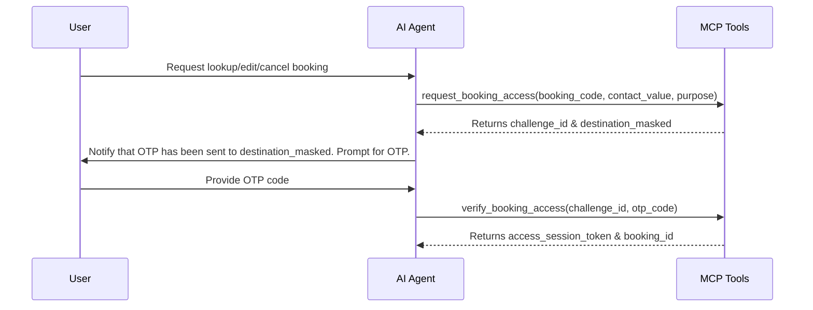

# Booking Skill: Process for Test Drive Appointments & Booking Management

This skill details how to interact with the backend booking services using 8 unified MCP tools (`search_test_drive_options`, `hold_test_drive_slot`, `get_booking_draft`, `update_booking_draft`, `request_booking_access`, `verify_booking_access`, `get_booking_details`, `confirm_test_drive_booking`).

---

## 🚀 1. Search Test Drive Options (`search_test_drive_options`)

The `search_test_drive_options` tool consolidates multiple backend processes (normalizing vehicle details, geocoding addresses, locating nearest showrooms, calculating distances, and fetching available slots). The Agent MUST NOT invoke sub-components separately.

### Key Input Fields:
- `vehicle_model`: The model of the vehicle (e.g., VF3, VF5, VF7, VF8, VF9).
- `vehicle_variant` (optional): The specific variant (e.g., Plus, Eco).
- `address` (optional): The user's address/location to find the closest showroom.
- `showroom_id` (optional): The ID of a specific showroom.
- `preferred_date`, `preferred_time` (optional): Desired schedule preferences.

### Execution Stages:

### UI synchronization rules
- The booking UI context is authoritative for the currently selected vehicle and step.
- When the user asks to view, choose, or switch to another vehicle, call `search_test_drive_options` with `vehicle_model` even if no address is known yet. Confirm the switch and ask for a location; do not ask them to choose the vehicle again.
- When the user gives a location, call `search_test_drive_options` with that `address` and the vehicle from the current UI context. Only ask for a vehicle if the context does not contain one.
- A vehicle-only search updates the vehicle panel and provides location suggestions. A search containing an address updates the showroom map. State that transition clearly in the answer.
- Do not invent vehicle, showroom, distance, or availability data. UI cards are populated from the completed tool result.

#### Stage 1: Showroom Selection (`search_stage = "showroom_selection"`)
- **Condition**: User provided an address/location, but no specific showroom is selected.
- **Behavior**: Returns a list of matching showrooms, distances, and their nearest available slots.
- **Agent Action**: Inform the user that the showroom map and list have been loaded on the right panel. To avoid visual redundancy and keep the chat clean, DO NOT write tables or lists of all showrooms in the chat text. Simply direct the user to click on the map marker or select from the list in the right-hand workspace.

#### Stage 2: Slot Selection (`search_stage = "slot_selection"`)
- **Condition**: A specific showroom is selected (`showroom_id` is supplied).
- **Behavior**: Returns a list of open timeslots (`slots[]`) at the showroom.
- **Agent Action**: Show available slots and guide the user to select their preferred time. **If the user specifies a timeslot in their message (e.g. "21 giờ 8/8 đi", "tôi chọn 22:30 ngày 7/8", etc.), you MUST verify it matches the available slots. If the user's request is contradictory (e.g. choosing "Thứ 6 ngày 8/8" while August 8th is Saturday), you must clarify the correct date with them instead of guessing. Otherwise, immediately call `hold_test_drive_slot` to hold the slot for them.** Do not tell them to click the UI if they have already told you their choice in text chat!

---

## 🔏 1.5. Hold Test Drive Slot (`hold_test_drive_slot`)
- **Purpose**: Reserve an available slot in `held` status for 15 minutes.
- **Agent Action**: Call this tool immediately when the user requests or selects a specific timeslot in the text chat (e.g., "tôi chọn 21:00", "lấy 22:30 ngày 7/8", etc.).
- **Inputs**:
  - `slot_id`: The ID of the slot to hold.
  - `ui_action_id`: A random UUID or unique ID.
- **Behavior**: This will trigger the confirmation modal on the screen. The user can then click "Xác nhận" to confirm.

---

## 📋 2. Draft Booking Management (`get_booking_draft` & `update_booking_draft`)

When a user selects a slot, the system creates a temporary held reservation (Draft Booking) in `held` state with a time-to-live (`hold_expires_at`).

### Step 2.1: Retrieve Draft (`get_booking_draft`)
- **Purpose**: Retrieve the current held draft details for forms and validations.
- **Important Outputs**:
  - `missing_required_fields[]`: Mandatory fields that must be filled before confirmation.
  - `validation_warnings[]`: Non-blocking validations (e.g., license nearing expiry).
  - `remaining_seconds`: Remaining seconds of the hold.
  - `is_ready_to_confirm`: Boolean indicating if all data is valid and the booking is ready.

### Step 2.2: Update Draft (`update_booking_draft`)
- **Purpose**: Apply partial patches to the draft from the user's input.
- **Inputs**:
  - `booker_patch`: Contact details of the booker.
  - `driver_patch`: Driver information (if different from booker).
  - `has_valid_license_commitment`: Boolean — `true` if the driver confirms they have a valid driving license, `false` if not. **DO NOT ask for license number or license class.** Only ask: *"Bạn có giấy phép lái xe hợp lệ không?"*
  - `notification_plan_patch`: Notification channels (SMS, Email, Zalo).
  - `expected_version`: Version token to prevent dirty write conflicts between UI and Agent.
- **Rules**:
  - Updates only succeed if the draft is `held` and not expired (`remaining_seconds` > 0).
  - **Do not** use this tool to change slots or finalize/confirm bookings.
  - **Never** ask the user for `license_number` or `license_class`. The system only requires a boolean commitment.

---

## 🔐 3. Access Verification for Existing Bookings

To view or edit existing bookings, users must authenticate using an OTP challenge.

### Step 3.1: Request OTP Access Challenge (`request_booking_access`)
- **Inputs**:
  - `booking_code`: The existing booking identifier.
  - `contact_value`: Registered phone number or email address.
  - `purpose`: Reason for lookup (`lookup`, `reschedule`, `cancel`, `update_details`, `update_notifications`).
- **Security Rule**:
  - NEVER output the raw `contact_value` in the response. Always use `destination_masked` returned from the tool.

### Step 3.2: Verify OTP Challenge (`verify_booking_access`)
- **Inputs**:
  - `challenge_id`: The ID returned during the request step.
  - `otp_code`: The OTP code entered by the user.
- **Rules**:
  - OTPs are single-use. If verification succeeds, you receive an `access_session_token`.
  - This token is required for all subsequent queries on this booking.

---

## 🔍 4. View Confirmed Booking Details (`get_booking_details`)

- **Purpose**: Get comprehensive details of a booking after verification.
- **Inputs**:
  - `booking_id` or `booking_code`.
  - `access_session_token` (mandatory).
- **Rules**:
  - Always enforce token check. Show only permissions allowed under the token's scope (`permissions[]`).

---

## 🎫 5. Confirm Booking (`confirm_test_drive_booking`)
- **Purpose**: Finalize the draft booking and generate a permanent booking code.
- **Agent Action**: Call this tool immediately when the user requests or confirms they want to chốt/xác nhận đặt lịch in the text chat (e.g. "ok chốt đi", "xác nhận đặt lịch", etc.).
- **Inputs**:
  - `booking_id`: The ID of the draft booking.
  - `expected_version`: The current version of the booking.
  - `ui_action_id`: A random UUID or unique ID.
